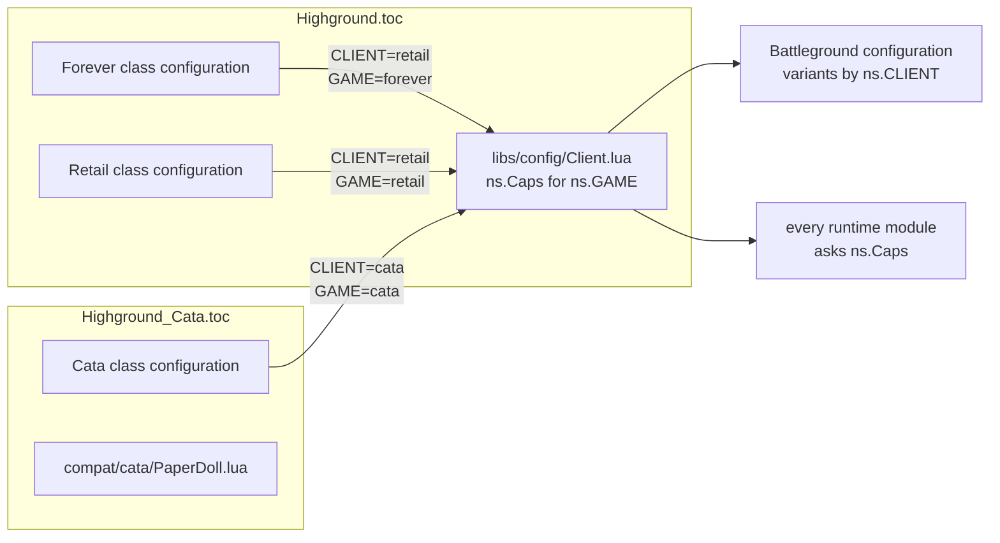
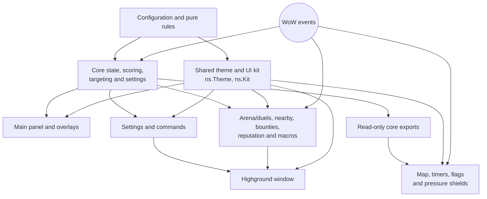

# Development

[Documentation](README.md) · [Highground overview](../README.md)

Highground uses Lua 5.1 (LuaJIT in tests) and the repository's shared HighgroundKit library. It has no external Lua dependencies. Each file gets the addon namespace through `local _, ns = ...`; there is no `require`.

Highground loads its own code (kill order, settings, setup, the Highground window and `/hg`), HighgroundKit through `libs/`, and feature files through `features/<name>/` links to their owning addons. Bounties and nearby enemies live in the library; `features/bounties/` supplies the bounty sound. The [monorepo](../../../docs/monorepo.md) guide covers ownership and source installation.

## Repository layout

Unless marked as repository-root paths, paths below are relative to `addons/Highground/`. Edit shared files at their source location; the `libs/` and `features/` links resolve there.

| Location | Responsibility |
| --- | --- |
| [features/battlegrounds/config/Shared.lua](../../HighgroundBattlegrounds/src/config/Shared.lua) | Armor and fallback role profiles |
| [libs/config/Theme.lua](../../../libs/HighgroundKit/config/Theme.lua), `libs/config/themes/` | Design tokens: Highground, Ember, Parchment, Azeroth and Class Colors ([design system](design-system.md)) |
| [libs/config/UI.lua](../../../libs/HighgroundKit/config/UI.lua) | Panel sizes, scale and opacity bounds, appearance choices, older colour names over the tokens |
| [config/Focus.lua](../config/Focus.lua) | Teammate pressure shields: clients, count, size |
| `features/battlegrounds/config/retail/`, `features/battlegrounds/config/forever/`, `features/battlegrounds/config/cata/` | Class IDs, spec profiles, matchups and range probes per game; Cata also auras, cooldown kits and spec clues |
| [libs/config/Client.lua](../../../libs/HighgroundKit/config/Client.lua) | Per-game capabilities (`ns.Caps`); each game's name, label, arena size and shared content (`ns.Games`) |
| [features/macros/config/Macros.lua](../../HighgroundMacros/src/config/Macros.lua) | Macro vocabulary (`Macros.Config`): units, raid markers, modifiers, sequence resets, equipment slots |
| [features/battlegrounds/config/Battlegrounds.lua](../../HighgroundBattlegrounds/src/config/Battlegrounds.lua), `features/battlegrounds/config/battlegrounds/` | Battleground registry and resolver; one rules file per battleground ([battleground rules](battleground-rules.md)) |
| [libs/config/Options.lua](../../../libs/HighgroundKit/config/Options.lua), `libs/config/catalog/` | Common settings and feature-specific catalogs: pages, switches, behavior, scoring, bounds and client visibility |
| [config/Commands.lua](../config/Commands.lua) | Command catalog (`ns.CommandCatalog`): every `/hg` command and preview button |
| `features/battlegrounds/rules/` | Pure rules: range, flag stacks, cooldowns, spec inference. No WoW API calls |
| [libs/core/Util.lua](../../../libs/HighgroundKit/core/Util.lua) | Shared helpers (`ns.Util`), see [below](#shared-utilities) |
| [libs/core/Codec.lua](../../../libs/HighgroundKit/core/Codec.lua) | Base64 (`ns.Codec`) for profile and macro strings |
| [libs/core/Router.lua](../../../libs/HighgroundKit/core/Router.lua), `libs/core/RouterNavigation.lua` | Named UI routes (`ns.Router`), guards, redirects, events and memory history ([router guide](router.md)) |
| `features/battlegrounds/core/` (State, Roster, Units, Auras, Specs, Lifecycle, Events, CombatLog, …) | The battleground engine: match state, roster, observations, event wiring |
| `core/` (Scoring, Targeting, Calling, Bursts, Preview, Diagnostics) | Kill order: scoring and target selection |
| [features/battlegrounds/core/Settings.lua](../../HighgroundBattlegrounds/src/core/Settings.lua) | One schema for settings from pages, commands, profiles and saved variables |
| [features/battlegrounds/core/Features.lua](../../HighgroundBattlegrounds/src/core/Features.lua) | `Core.SetFeature`, `Core.ResetTuning`, `Core.StopTest` |
| [features/battlegrounds/core/Migrations.lua](../../HighgroundBattlegrounds/src/core/Migrations.lua) | Saved-variable setup, validation and one-time upgrades |
| [core/Bursts.lua](../core/Bursts.lua) | Burst answers (PURGE or CC) for Cata burst markers |
| `features/battlegrounds/core/Capping.lua`, `features/battlegrounds/core/CapProbe.lua`, `features/battlegrounds/core/CapShare.lua` | Base captures in progress, diagnostics, sharing your own captures |
| [libs/core/Comms.lua](../../../libs/HighgroundKit/core/Comms.lua) | Addon messages (`ns.Comms`): group channel, send, one listener per prefix for captures, timers, map intel and bounties |
| [libs/core/Network.lua](../../../libs/HighgroundKit/core/Network.lua) | Shared bounded transport (`ns.Network`): queues, fragmentation, retries and authorization hooks ([networking guide](../../../docs/networking.md)) |
| [libs/core/Chat.lua](../../../libs/HighgroundKit/core/Chat.lua) | Chat drafts, token filters and link hooks (`ns.Chat`); feature modules own payload validation and link actions |
| `libs/social/`, `libs/core/Scope.lua` | Native guild/community identity, membership, permissions and shared game/realmset boundaries |
| [features/battlegrounds/core/Exports.lua](../../HighgroundBattlegrounds/src/core/Exports.lua) | Read-only core API for modules loaded later |
| [libs/ui/Theme.lua](../../../libs/HighgroundKit/ui/Theme.lua), `libs/ui/kit/` | Theme API (`ns.Theme`) and shared controls (`ns.Kit`) |
| [libs/ui/Motion.lua](../../../libs/HighgroundKit/ui/Motion.lua), `libs/ui/kit/Feedback.lua` | Token-based alpha transitions, control feedback and cancellable entrances; obey Reduced motion |
| `ui/` (Panel, Rows, Hero, Render, Layout, Actions, Tooltip, …) | Main panel, kill-target card, secure buttons, layout |
| `features/battlegrounds/ui/` (Compact, Appearance, Scale, CapPlates) | Compact docking, appearance, UI scale, capture bars |
| [libs/ui/Windows.lua](../../../libs/HighgroundKit/ui/Windows.lua), [libs/ui/Restore.lua](../../../libs/HighgroundKit/ui/Restore.lua) | HUD windows (timers, flags, arena, nearby) and the secure target-then-return macros |
| [libs/ui/Hud.lua](../../../libs/HighgroundKit/ui/Hud.lua) | Battleground panel rows (`Hud.UnitRow`) and the secure target/focus macros (`Core.SetTargetFocus`) |
| `ui/Sniper.lua`, `ui/HealerMarks.lua`, `ui/BurstMarks.lua`, `features/battlegrounds/ui/CapPlates.lua`, `ui/Focus.lua` | World overlays: target marker, healer crosses, burst markers, capture bars, pressure shields |
| [ui/Minimap.lua](../ui/Minimap.lua) | Minimap button and menu |
| `options/` | Settings pages, role setup (`Setup`, `SetupLayout`), named profiles and validation (`Profiles`, `ProfileData`, `ProfileSetup`), activity assignments (`ProfileAssignments`), sharing and review (`ProfileSharing`, `ProfileReview`) |
| `commands/` | `/hg` dispatch and handlers |
| `features/battlegrounds/map/` | Enemy map positions (`ns.Intel`), sharing, pins (`ns.MapPins`, `features/battlegrounds/map/Pins.xml`) |
| `features/battlegrounds/timers/` | Graveyards, captures, resurrection estimates, resource predictions, objective overview, observed mechanics and map layer (`ns.Timers`) |
| `features/battlegrounds/flags/` | Flag carriers and the carrier window (`ns.Flags`); hides Blizzard's carrier frames and quest tracker |
| `features/arena/arena/` | Arena and duel panel (`ns.Arena`), opponent identity, spec clues, client-reported trinkets, cast/CC displays and observed Cata diminishing returns and interrupts |
| `features/reputation/reputation/` | Player reports, native-organization moderation, chat filtering, synchronization and workspace (`ns.Reputation`) |
| `libs/world/` | Nearby enemies (`ns.Nearby`), encounter history and mute preferences (`ns.NearbyHistory`), localized honor messages (`ns.Honor`) and enemy journal UI |
| `libs/pvp/` | Saved match results and the match-history window (`ns.MatchHistory`) |
| `libs/core/Alerts.lua`, `libs/ui/Alerts.lua` | Alert priorities, category controls and presets |
| `libs/bounty/` | Bounties (`ns.Bounty`): personal/guild/community state, contributions and combined pots, transport adapters, account gold, claims, sightings, portraits, board, guides and commands |
| `features/macros/macros/` | Presets, builder, compiler, explanations, completion, localization, rank updates, import review and backups. `HostBase` provides the shared half of `Macros.Host`; Highground's adapter is `macros/Host.lua` |
| `hub/` | Highground window (`ns.Hub`): borrowed pages (`Hub`), sidebar groups (`Navigation`), overview (`Home`), resumable chapters (`Onboarding`, `TourSteps`, `TourView`) and visual walkthroughs (`Coach*`). Chapters and coach steps use `ns.Router`; `CoachTargeting` feeds observations into the real enemy panel; `CoachMap` supplies isolated observations to the real intel renderer and world-map provider. `CoachExamples` hosts only the nameplate marker scene. Other guides use their feature's own windows and controls. |
| `compat/cata/` | Cata character-pane guard |
| `tests/` | Validator, unit tests and full-addon [simulations](simulations.md). The simulator (with its battleground extension), lint and test harness are in the repository's `tools/`; packaging, release and layout tests in its `tests/` |
| `scripts/` (repository root) | ZIP builds, GitHub releases, CurseForge/Wago uploads and shared-file checks ([releases](../../../docs/releases.md)) |
| `.github/workflows/` (repository root) | CI: `ci.yml` coordinates shared checks, addon builds through `addon.yml`, and publication |

## Client isolation

Each TOC loads shared files and one class configuration. `Highground.toc` serves Retail and WoW Forever; each class file there returns early unless the interface number is its game's.



- `ns.CLIENT` (`"retail"` or `"cata"` in Highground) selects data: class tables, battleground variants and settings marked `cata = true` or `retail = true` in the library's settings catalog (`ns.OptionAvailable`). Highground Macros also uses `"classic"` for Classic Era and TBC.
- `ns.Caps` says what the game's API allows: combat log, readable enemy health and power, spec trees, pings, Blitz. Check a capability, not a client name.

A new game needs class configuration that sets `ns.CLIENT` and `ns.GAME`, a row in `libs/config/Client.lua`, and matching standalone detection in `libs/standalone/Bootstrap.lua` where supported.

## Module boundaries



| Namespace | Owner | Holds |
| --- | --- | --- |
| `ns.Core` | `features/battlegrounds/core/`, `core/` | Match state, enemies, scoring, settings, feature switches |
| `ns.Util`, `ns.Codec` | `libs/core/Util.lua`, `libs/core/Codec.lua` | Shared helpers, base64 |
| `ns.Router` | `libs/core/Router.lua`, `libs/core/RouterNavigation.lua` | Shared routing for hub, feature tabs, guides and dialogs across all UI addons; see [adoption](router.md#adoption-across-highground) |
| `ns.Theme`, `ns.Kit` | `libs/ui/Theme.lua`, `libs/ui/kit/` | Tokens and controls |
| `ns.Options` | `options/` | Settings pages and profiles |
| `ns.Commands`, `ns.CommandCatalog` | `commands/`, `config/Commands.lua` | Handlers by first word; the listed commands |
| `ns.Intel`, `ns.MapPins` | `features/battlegrounds/map/` | Enemy positions, map pins |
| `ns.Timers`, `ns.Flags` | `features/battlegrounds/timers/`, `features/battlegrounds/flags/` | Battleground timers and windows, carriers |
| `ns.Arena`, `ns.Nearby` | `features/arena/arena/`, `libs/world/` | Arena/duel panel, nearby enemies |
| `ns.Bounty`, `ns.Macros` | `libs/bounty/`, `features/macros/macros/` | Bounties, macros |
| `ns.Reputation` | `features/reputation/reputation/` | Player reports, moderation and filtering |
| `ns.Network`, `ns.Guild`, `ns.Organizations` | `libs/core/Network.lua`, `libs/social/` | Shared transport and native organization services |
| `ns.Alerts`, `ns.MatchHistory`, `ns.EnemyJournal` | `libs/core/Alerts.lua`, `libs/pvp/`, `libs/world/Journal.lua` | Alert controls, PvP results, enemy journal |
| `ns.Hub` | `hub/` | Highground window |
| `ns.Test` | any | Test-only hooks for the simulator |

Rules between modules:

- **Core API.** [features/battlegrounds/core/Exports.lua](../../HighgroundBattlegrounds/src/core/Exports.lua) is the read-only core API for modules that load after core: `ns.enemies`, `ns.GetDB`, `ns.GetPositions`, `ns.IsActive`, `ns.GetKillNow`, `ns.GetBG`, `ns.GetBGRules`, `ns.CanonUnit` and more. Map, timers, flags and pressure shields use it. Prefer it in new code over `ns.Core` fields.
- **Changes with side effects** go through one function, used by pages and commands alike: `Core.SetFeature(key, on)` for switches, `Core.SetTuning(kind, key, value)` for validated tuning values, `Core.ResetTuning()`, `Core.StartTest()` / `Core.StopTest()`, `Theme.Use(name)`.
- **Bounty events.** `libs/bounty/State.lua` owns personal, guild and community entries. It emits events (`added`, `publish`, `changed`, `shared`, `claimed`, `updated`) through `Bounty.Emit`; Sync, Alerts and the board subscribe with `Bounty.Listen(event, fn)`. Each listener runs guarded. Shared contributions use the `Public*` modules and the data dependency's saved variables.
- **Sharing layers.** `Comms.Send` returns whether the game accepted a message. `Network` owns bounded queues, fragmentation, assembly and retries; features own audiences, payload validation and reconciliation. `bounty/PublicWire.lua` adapts bounty routing to it, `PublicMessages.lua` owns payload fields, versions and dispatch, and `PublicTransport.lua` owns channel discovery and scheduling. Append positional wire fields instead of reordering them. `Chat.Draft`, `Chat.LinkFilter` and `Chat.InstallLinks` provide chat API compatibility for profiles and bounties; import reviews stay with each feature. See [networking](../../../docs/networking.md).
- **Honor credit.** `Honor.Name(message)` parses a named victim from localized honor chat, without choosing a target or assuming a killing blow. Nearby history resolves the name against known encounters; bounties apply their own identity and claim rules. Mute preferences belong to the history model and remain usable without the journal UI or new encounter recording.
- **Hub borrowing.** The hub reparents settings and feature windows into its content area while shown, then hands them back. Home and the feature guide have their own modules. While borrowed, a window's `frame.close` is hidden and dragging is off. `Hub.Release(frame)` closes the hub when a command opens that window on its own. The same settings pages remain available through Blizzard's panel.
- **UI routing.** `Hub.Navigate(target)` and `Hub.RegisterRoute(name, definition)` connect components to the hub's router. Existing `Hub.Open`/`Hub.Show` callers also use it. Features expose their own routers through `Kit.AttachNavigation`; the hub delegates Back/Forward to the active feature. `Kit.Windows.router` coordinates ordinary dialogs across addon copies. Guards run before entry; `capture` preserves per-visit drafts. Bounded history lasts for the session. See [UI routing](router.md) for the API and adoption map.
- **Secure frames.** Click targets (rows, card, carriers, arena, nearby, key buttons) are secure. Their attributes, size, position and visibility change only out of combat; changes asked for in combat wait for `PLAYER_REGEN_ENABLED`. Battleground windows hide through `Timers.SecureHide` (fades out in combat) and show through `Timers.SecureShow` (waits for the end of combat). Kit controls are plain frames and work in combat.
- **Battleground rules** are resolved configuration. Runtime code must not change them.

## Shared utilities

`ns.Util` ([libs/core/Util.lua](../../../libs/HighgroundKit/core/Util.lua)) provides common helpers to the addon and feature modules.

| Helper | Use |
| --- | --- |
| `Util.Say(text[, kind])` | Shared chat format: coloured addon label, then text. `kind`: `"bounty"`, `"error"`, `"warning"` |
| `Util.Guard(stage, fn, ...)` | The one error wrapper: runs `fn` protected and records failures for `/hg err` |
| `Util.Events(handlers[, name])` | Event frame; each handler runs through `Util.Guard`; unknown events are skipped |
| `Util.Every(seconds, fn[, name])` | Guarded throttled update; returns a handle with `:Stop()` and `:Start()` |
| `Util.secret(v)`, `Util.plain(v)`, `Util.value(v)` | Secret values on Retail and Forever: test, readable boolean, value or nil |
| `Util.call(fn, ...)`, `Util.read(fn, ...)` | `pcall` returning results; first result when readable |
| `Util.Clean(s)` | Strip addon-message separators |
| `Util.Trim(s)`, `Util.Split(s[, sep])` | Trim spaces; split on one character (default `,`) into trimmed pieces, empty ones dropped |
| `Util.Plural(n, word)` | `"1 error"`, `"2 errors"`; an upper-case word takes `S` (`"2 ERRORS"`) |
| `Util.Ago(seconds)` | `"now"` (under 3 s), `"42s"`, `"7m"` |
| `Util.ClassName(class)`, `Util.SortClasses(list)` | A class token's name in the game's language; sort tokens by it |
| `Util.SpellName(id)`, `Util.SpellTexture(spell)`, `Util.SpellID(name)` | Spell data on every client (`C_Spell` or the old globals); `SpellID` gives your highest known rank. nil when unknown or secret |
| `Util.HealthFraction(unit)` | Health from 0 to 1, or nil (unknown, secret or no maximum) |
| `Util.ZoneName()`, `Util.Gold(n)`, `Util.AlertSound()`, `Util.MyTeam()`, `Util.ClassColor(class)` | Small game helpers |

Never compare a secret value or use it as a table key: pass it to `Util.value` first.

The kit has two small helpers for any frame ([libs/ui/kit/Controls.lua](../../../libs/HighgroundKit/ui/kit/Controls.lua)): `Kit.Tooltip(frame, lines[, opts])` adds a hover tooltip (a list of lines or a function returning one; the first line is the title), and `Kit.ClassIcon(texture, class)` shows a class icon from the game's atlas and returns whether it has one. See the [design system](design-system.md#kit).

## Async attempts and state transitions

`ns.Async` ([libs/core/Async.lua](../../../libs/HighgroundKit/core/Async.lua)) guards callbacks across retries, replacement and cancellation. Create an operation with `Async.New()`, then keep the attempt returned by `operation:Start(value)` in every delayed callback:

```lua
local operation = ns.Async.New()
local attempt = operation:Start(record)
C_Timer.After(8, function()
  if operation:Finish(attempt, "failed", "Timed out") then
    -- Only this still-current attempt may update its UI or release a queue.
  end
end)
```

`IsCurrent(attempt)` checks ownership before starting delayed work. `Finish(attempt, outcome, message)` accepts `succeeded`, `failed`, `cancelled` or `unavailable`, and returns false for stale or already completed attempts. `Cancel()` retires the current attempt; starting a replacement cancels the old one. Operations start `idle`, become `pending`, then retain the latest outcome. The helper owns no timers, retries, frames or saved variables. Native events without a request ID still require a feature-specific correlation check.

The state audit covers these shared boundaries:

| Boundary | Handling and regression coverage |
| --- | --- |
| Browser data and actions | Explicit loading/error/unavailable/disabled/filtered/empty states, stale selection checks, action eligibility, error-tone recovery; `tests/ui_states.lua` in every UI package |
| Claims storage | Unsupported saved-data versions show a storage error and disable actions instead of presenting an empty payment ledger; covered in all three bounty clients |
| Selectors and toggles | Renamed/removed choices, disabled or hidden menu owners, native enabled state and theme repaint; the same shared UI suite |
| Native organizations | `Organizations.List()` and `Members(id)` return a second readiness result; reputation distinguishes a pending roster from a failed search; Reputation's `states_test.lua` exercises standalone and embedded views |
| Bounty board selection | Returning to a departed organization resolves a live selection consistently in the model and control; preview choices use the same contract |
| Screenshot capture | Per-attempt deadlines, unsupported API, cancellation, failure and retry; `tests/bounty_hunts.lua` in all three bounty clients plus `tests/async_test.lua` |

Combat deferral, unknown opponent cooldowns, router guards, profile transfer cancellation and network permission checks retain their existing feature-specific behavior and regression suites. Simulator checks validate transitions and load order; native game rendering and uncorrelated screenshot events still need in-game verification.

## Saved variables

| Variable | Scope | Holds |
| --- | --- | --- |
| `HighgroundDB` | Account | Settings, tuning, profiles and assignments, setup progress, appearance, alerts, personal/guild bounties, match and enemy histories, macro preferences/backups, learned battleground data and errors |
| `HighgroundCharDB` | Character | Panel positions (`Core.POSITION_KEYS`) |
| `HighgroundMacrosDB` | Account | Macro preferences, backups, theme, window positions and errors; WoW owns the actual macros |
| `HighgroundBountyNetworkDB` | Account | Shared bounty identity, contributions, funding reports and claims; declared only by HighgroundBountyData |
| `HighgroundReputationNetworkDB` | Account | Native organization opt-ins, reports and moderation history; declared only by HighgroundReputationData |
| Other standalone `<Addon>DB` variables | Account | That addon's settings and feature data; HighgroundBattlegrounds also uses `<Addon>CharDB` for character panel positions |

In Highground, on `ADDON_LOADED`, `Core.LoadSaved` ([features/battlegrounds/core/Migrations.lua](../../HighgroundBattlegrounds/src/core/Migrations.lua)) initializes `HighgroundDB` and `HighgroundCharDB`, fills defaults from `Core.DEFAULTS` ([features/battlegrounds/core/State.lua](../../HighgroundBattlegrounds/src/core/State.lua)), resets damaged values with `Core.ValidateSaved` (shapes in `Core.SavedDefs`, [features/battlegrounds/core/Settings.lua](../../HighgroundBattlegrounds/src/core/Settings.lua)) and runs one-time upgrades. Tuning values are checked against `Core.SettingDefs`. Profile imports are validated into a copy first ([options/ProfileData.lua](../options/ProfileData.lua)); an invalid known value rejects the whole profile, retired keys are ignored. Keep `false` booleans and explicit zero values.

Add an upgrade to `Core.LoadSaved` under a new version key (`Versioned`). Do not change an old one.

## Load order

The [Retail/Forever TOC](../Highground.toc) and [Cata TOC](../Highground_Cata.toc) are the authoritative load order. They interleave library, feature and Highground modules: configuration and pure rules first, core state and services next, then UI, settings, feature windows and the hub. Theme definitions follow `libs/config/Theme.lua`; client-specific class data loads before capability and battleground resolution. Cata ends with its compatibility guard.

A file can use another module at load time only if it loads earlier. Otherwise look it up when the function runs. Register new runtime files in each applicable TOC, including the owning standalone addon's TOCs for shared features.

## Conventions

- No globals. `tests/validate.py` fails on global writes outside its allowlist (saved variables, slash commands, key bindings, names XML needs). Declare names `local` or put them on `ns`.
- Every runtime file must be in both TOCs (or only the client's own folder); the validator checks.
- Colours are theme tokens ([design system](design-system.md)).
- Chat output through `Util.Say`, errors through `Util.Guard`.
- **400 lines** per maintained text file, aim for under 300. Split at functions and features.
- Comments and docs: short and plain.
- When a command changes, update `config/Commands.lua` and [commands](commands.md) together; `tests/docs_test.lua` checks they match.

## Validation

Run from the repository root with Python 3.10+ and LuaJIT:

```sh
bash tests/run.sh
```

The runner executes each addon's validator and Lua tests from its folder, then discovers the repository's `tests/test_*.py` suites. Those cover addon metadata, packaging, layout, publishing, release checks and theme integration. Highground's tests include manifest/XML checks, globals, colour literals, line limits, Lua 5.1 compilation, unit tests and [simulations](simulations.md). Simulations do not certify real in-client secure actions.

For one addon, use `bash tests/run.sh HighgroundMacros` (repository tests still run). Use `bash tests/run.sh --addons-only HighgroundMacros` for only the addon tests, or `bash tests/run.sh --repository-only` for packaging, release and cross-addon integration tests. [Builds and releases](../../../docs/releases.md) explains the checks required before publishing.

### Before release

Test both clients in combat:

- Join an ongoing flag match.
- Assault, defend and capture a graveyard.
- Turn the flags and timers features off and on.
- Enter two matches in a row.
- Click the card and enemy rows before and during combat, including a changed recommendation and right-click focus.

Capture unknown POI atlases, map IDs and chat messages for new fixtures. See [builds and releases](../../../docs/releases.md).

## First-use defaults

`OptionsConfig.firstRun` is extended by feature catalogs and copied only when the account saved-variable table does not exist. Highground and Battlegrounds apply it in `Core.LoadSaved`; other standalone addons apply it in `Standalone.Start`. A present empty table counts as an existing installation. Historical implicit defaults still apply there, so a feature release does not silently change existing choices. The battleground scope migration separately enables unrated matches once for existing accounts and saved setups.

Do not change `Core.DEFAULTS` or `Core.On` to implement a quieter first install. Those also supply values for existing accounts and older profiles. Keep fresh-install scenarios separate from legacy/full-feature fixtures. Every addon loading the standalone settings page must include `ui/kit/Workspace.lua` for its scroll area.

The first installation offers independent addon guides outside combat and instances. `hub/Onboarding.lua` owns account progress and cleanup; `TourSteps.lua` lists available guides and `TourView.lua` renders the chooser. `Coach.lua` uses the shared router for step history, required action openers and resume. `CoachView.lua` owns precise highlights, pointer movement and a scrollable explanation with fixed navigation. Guides reuse native UI builders: explicit providers isolate sample bounties, histories and reputation reports; Quick Call routes sample clicks to local feedback. Macros and settings use live tools, with real save actions labelled. Sample enemy rows reuse `Core.CreateRow` without secure actions so combat cleanup stays possible. Never replace saved stores or global handlers to simulate a guide.

Bounty guides use separate `bounty_post` and `bounty_hunt` routes and saved progress under the `bounties` path picker. A step can opt into assisted Next with `action()` returning its native sample button. The coach animates to that button and invokes its normal click, preserving validation and hooks; it never opts live save/send actions into this behavior. Navigation, dismissal and combat cancel a pending click. Reduced motion performs it immediately. Back follows the router's visited history, including branches; on the first step it returns to the chooser. Conditional steps can return a destination ID from `next()` so revisiting a rejected claim skips payment. The tracking menu's explicit `keepOpenFor` control lets Next activate its highlighted native item without an outside mouse press closing it first.
