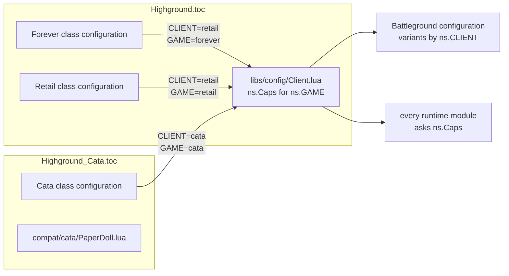
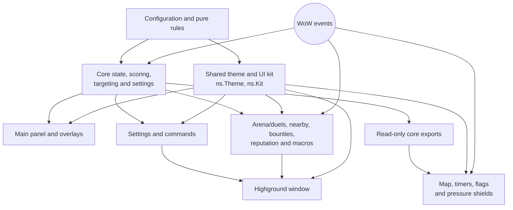

# Development

Highground is the only supported distribution. References below to standalone hosts describe retained source and regression coverage, not separate supported downloads.

Highground owns the full shared-feature regression coverage. Retained standalone suites focus on host loading, coexistence, saved-data isolation, command/UI routing and host-specific behavior; they also keep feature coverage that has no Highground equivalent. Do not add a standalone wrapper for an unchanged shared scenario already covered by Highground unless it exercises a distinct compatibility path.

Arena display/spec inference, flag-carrier display, stealth, nearby history, and bounty causes/details/gold/hunts/portraits/posters/sightings run through Highground only. Standalone duel commands, nearby controls, bounty guides/live previews, network interoperability, data scope, UI state/navigation and panel controls still have host-specific runs. Unique Bounties and Reputation suites remain in their owning folders; running only Highground does not replace `bash tests/run.sh --jobs 4` for repository-wide validation.

[Documentation](README.md) · [Highground overview](../README.md)

Highground uses Lua 5.1 (LuaJIT in tests) and the repository's shared HighgroundKit library. It has no external Lua dependencies. Each file gets the addon namespace through `local _, ns = ...`; there is no `require`.

Highground loads its own code (kill order, settings, setup, the Highground window and `/hg`), HighgroundKit through `libs/`, and feature files through `features/<name>/` links to their owning addons. Bounties and nearby enemies live in the library; `features/bounties/` supplies the bounty sound. The [monorepo](../../../docs/monorepo.md) guide covers ownership and source installation.

## Repository layout

Unless marked as repository-root paths, paths below are relative to `addons/Highground/`. Edit shared files at their source location; the `libs/` and `features/` links resolve there.

| Location | Responsibility |
| --- | --- |
| [features/battlegrounds/config/Shared.lua](../../HighgroundBattlegrounds/src/config/Shared.lua) | Armor and fallback role profiles |
| [libs/config/Theme.lua](../../../libs/HighgroundKit/config/Theme.lua), `libs/config/themes/` | Design tokens: Highground, Ember, Parchment, Azeroth and Class Colors ([design system](design-system.md)) |
| [libs/config/UI.lua](../../../libs/HighgroundKit/config/UI.lua) | Panel sizes, scale and opacity bounds, appearance choices, older colour names over the tokens |
| [config/Focus.lua](../config/Focus.lua) | Teammate pressure shields: clients, count, size |
| `features/battlegrounds/config/retail/`, `features/battlegrounds/config/forever/`, `features/battlegrounds/config/cata/` | Class IDs, spec profiles, matchups and range probes per game; Cata also auras, cooldown kits and spec clues |
| [libs/config/Client.lua](../../../libs/HighgroundKit/config/Client.lua) | Per-game capabilities (`ns.Caps`); each game's name, label, arena size and shared content (`ns.Games`) |
| [features/macros/config/Macros.lua](../../HighgroundMacros/src/config/Macros.lua) | Macro vocabulary (`Macros.Config`): units, raid markers, modifiers, sequence resets, equipment slots |
| [features/battlegrounds/config/Battlegrounds.lua](../../HighgroundBattlegrounds/src/config/Battlegrounds.lua), `features/battlegrounds/config/battlegrounds/` | Battleground registry and resolver; one rules file per battleground ([battleground rules](battleground-rules.md)) |
| [libs/config/Options.lua](../../../libs/HighgroundKit/config/Options.lua), `libs/config/catalog/` | Common settings and feature-specific catalogs: pages, switches, behavior, scoring, bounds and client visibility |
| [config/Commands.lua](../config/Commands.lua) | Command registry and shared Highground commands; addon catalogs live in each feature’s `src/config/Commands.lua` |
| `features/battlegrounds/rules/` | Pure rules: range, flag stacks, cooldowns, spec inference. No WoW API calls |
| [libs/core/Util.lua](../../../libs/HighgroundKit/core/Util.lua), [libs/core/Events.lua](../../../libs/HighgroundKit/core/Events.lua), [libs/core/Throttle.lua](../../../libs/HighgroundKit/core/Throttle.lua) | Shared helpers (`ns.Util`); guarded calls, event frames and timers on the same table; burst coalescing (`ns.Throttle`), see [below](#shared-utilities) |
| [libs/core/Codec.lua](../../../libs/HighgroundKit/core/Codec.lua) | Base64 and length-prefixed data (`ns.Codec`) for profile, macro and Reputation strings; buffers are reused, output bytes are fixed |
| [libs/core/Router.lua](../../../libs/HighgroundKit/core/Router.lua), `libs/core/RouterNavigation.lua` | Named UI routes (`ns.Router`), guards, redirects, events and memory history ([router guide](router.md)) |
| [libs/core/Text.lua](../../../libs/HighgroundKit/core/Text.lua) | UTF-8 lengths, substrings and byte cuts (`ns.Text`), see [below](#utf-8-text) |
| `features/battlegrounds/core/` (State, Roster, Units, Auras, Specs, Lifecycle, Events, CombatLog, …) | The battleground engine: match state, roster, observations, event wiring |
| `core/` (Scoring, Targeting, Calling, Bursts, Preview, Diagnostics) | Kill order: scoring and target selection |
| [features/battlegrounds/core/Settings.lua](../../HighgroundBattlegrounds/src/core/Settings.lua) | One schema for settings from pages, commands, profiles and saved variables |
| [features/battlegrounds/core/Features.lua](../../HighgroundBattlegrounds/src/core/Features.lua) | `Core.SetFeature`, `Core.ResetTuning`, `Core.StopTest` |
| [features/battlegrounds/core/Migrations.lua](../../HighgroundBattlegrounds/src/core/Migrations.lua) | Saved-variable setup, validation and one-time upgrades |
| [core/Bursts.lua](../core/Bursts.lua) | Burst answers (PURGE or CC) for Cata burst markers |
| `features/battlegrounds/core/Capping.lua`, `features/battlegrounds/core/CapProbe.lua`, `features/battlegrounds/core/CapShare.lua` | Base captures in progress, diagnostics, sharing your own captures |
| [libs/core/Comms.lua](../../../libs/HighgroundKit/core/Comms.lua) | Addon messages (`ns.Comms`): group channel, send, one listener per prefix for captures, timers, map intel and bounties |
| [libs/core/Network.lua](../../../libs/HighgroundKit/core/Network.lua) | Shared bounded transport (`ns.Network`): queues, fragmentation, retries and authorization hooks ([networking guide](../../../docs/networking.md)) |
| [libs/core/Protocols.lua](../../../libs/HighgroundKit/core/Protocols.lua), `libs/core/ProtocolTransport.lua` | Shared format registry, automatic capability announcements and directed compatibility checks (`ns.Protocols`); existing formats remain usable without a handshake |
| [libs/core/Chat.lua](../../../libs/HighgroundKit/core/Chat.lua) | Chat drafts, token filters and link hooks (`ns.Chat`); feature modules own payload validation and link actions |
| `libs/social/`, `libs/core/Scope.lua` | Native guild/community identity, membership, permissions and shared game/realmset boundaries |
| [features/battlegrounds/core/Exports.lua](../../HighgroundBattlegrounds/src/core/Exports.lua) | Read-only core API for modules loaded later |
| [libs/ui/Theme.lua](../../../libs/HighgroundKit/ui/Theme.lua), `libs/ui/kit/` | Theme API (`ns.Theme`) and shared controls (`ns.Kit`) |
| [libs/ui/Motion.lua](../../../libs/HighgroundKit/ui/Motion.lua), `libs/ui/kit/Feedback.lua` | Token-based transitions, native cues, control feedback and cancellable entrances; obey Reduced motion ([motion](design-system.md#motion-api-and-lifecycle)) |
| `ui/` (Panel, Rows, Hero, Render, Layout, Actions, Tooltip, …) | Main panel, kill-target card, secure buttons, layout |
| `features/battlegrounds/ui/` (Compact, Appearance, Scale, CapPlates) | Compact docking, appearance, UI scale, capture bars |
| [libs/ui/Windows.lua](../../../libs/HighgroundKit/ui/Windows.lua), [libs/ui/Restore.lua](../../../libs/HighgroundKit/ui/Restore.lua) | HUD windows (timers, flags, arena, nearby) and the secure target-then-return macros |
| [libs/ui/Hud.lua](../../../libs/HighgroundKit/ui/Hud.lua) | Battleground panel rows (`Hud.UnitRow`) and the secure target/focus macros (`Core.SetTargetFocus`) |
| `ui/Sniper.lua`, `ui/HealerMarks.lua`, `ui/BurstMarks.lua`, `features/battlegrounds/ui/CapPlates.lua`, `ui/Focus.lua` | World overlays: target marker, healer crosses, burst markers, capture bars, pressure shields |
| [ui/Minimap.lua](../ui/Minimap.lua) | Minimap button and menu |
| `options/` | Settings pages, role setup (`Setup`, `SetupLayout`), named profiles and validation (`Profiles`, `ProfileData`, `ProfileSetup`), activity assignments (`ProfileAssignments`), sharing and review (`ProfileSharing`, `ProfileReview`) |
| `commands/` | `/hg` dispatch and handlers |
| `features/battlegrounds/map/` | Enemy map positions (`ns.Intel`), sharing, pins (`ns.MapPins`, `features/battlegrounds/map/Pins.xml`) |
| `features/battlegrounds/timers/` | Graveyards, captures, resurrection estimates, resource predictions, objective overview, observed mechanics and map layer (`ns.Timers`) |
| `features/battlegrounds/flags/` | Flag carriers and the carrier window (`ns.Flags`); hides Blizzard's carrier frames and quest tracker |
| `features/arena/arena/` | Arena and duel panel (`ns.Arena`), opponent identity, spec clues, client-reported trinkets, cast/CC displays and observed Cata diminishing returns and interrupts |
| `features/reputation/reputation/` | Player reports, native-organization moderation, chat filtering, synchronization and workspace (`ns.Reputation`) |
| `libs/world/` | Nearby enemies (`ns.Nearby`), encounter history and mute preferences (`ns.NearbyHistory`), localized honor messages (`ns.Honor`) and enemy journal UI |
| `libs/pvp/` | Live PvP listeners and tickers (`ns.PvPEvents`), prebuilt unit tokens (`ns.UnitTokens`), stealth observers, saved match results and the match-history window (`ns.MatchHistory`) |
| `libs/core/Alerts.lua`, `libs/ui/Alerts.lua` | Alert priorities, category controls and presets |
| `libs/bounty/` | Bounties (`ns.Bounty`): personal/guild/community state, contributions and combined pots, transport adapters, account gold, claims, sightings, portraits, board, guides and commands |
| `features/macros/macros/` | Presets, builder, compiler, explanations, completion, localization, rank updates, import review and backups. `HostBase` provides the shared half of `Macros.Host`; Highground's adapter is `macros/Host.lua` |
| `hub/` | Highground window (`ns.Hub`): borrowed pages (`Hub`), sidebar groups (`Navigation`), overview (`Home`), resumable chapters (`Onboarding`, `TourSteps`, `TourView`) and visual walkthroughs (`Coach*`). Chapters and coach steps use `ns.Router`; `CoachTargeting` feeds observations into the real enemy panel; `CoachMap` supplies isolated observations to the real intel renderer and world-map provider. `CoachExamples` hosts only the nameplate marker scene. Other guides use their feature's own windows and controls. |
| `compat/cata/` | Cata character-pane guard |
| `tests/` | Validator, unit tests and full-addon [simulations](simulations.md). The simulator (with its battleground extension), lint and test harness are in the repository's `tools/`; packaging, release and layout tests in its `tests/` |
| `scripts/` (repository root) | ZIP builds, GitHub releases, CurseForge/Wago uploads and shared-file checks ([releases](../../../docs/releases.md)) |
| `.github/workflows/` (repository root) | CI: `ci.yml` coordinates shared checks, addon builds through `addon.yml`, and publication |

## Client isolation

Each TOC loads shared files and one class configuration. `Highground.toc` serves Retail and WoW Forever; each class file there returns early unless the interface number is its game's.



- `ns.CLIENT` (`"retail"` or `"cata"` in Highground) selects data: class tables, battleground variants and settings marked `cata = true` or `retail = true` in the library's settings catalog (`ns.OptionAvailable`). Highground Macros also uses `"classic"` for Classic Era and TBC.
- `ns.Caps` says what the game's API allows: combat log, readable enemy health and power, spec trees, pings, Blitz. Check a capability, not a client name.

A new game needs class configuration that sets `ns.CLIENT` and `ns.GAME`, a row in `libs/config/Client.lua`, and matching standalone detection in `libs/standalone/Bootstrap.lua` where supported.

## Module boundaries



| Namespace | Owner | Holds |
| --- | --- | --- |
| `ns.Core` | `features/battlegrounds/core/`, `core/` | Match state, enemies, scoring, settings, feature switches |
| `ns.Util`, `ns.Codec`, `ns.Text` | `libs/core/Util.lua`, `libs/core/Events.lua`, `libs/core/Codec.lua`, `libs/core/Text.lua` | Shared helpers, guarded events and timers, base64, UTF-8 text |
| `ns.Router` | `libs/core/Router.lua`, `libs/core/RouterNavigation.lua` | Shared routing for hub, feature tabs, guides and dialogs across all UI addons; see [adoption](router.md#adoption-across-highground) |
| `ns.Theme`, `ns.Kit` | `libs/ui/Theme.lua`, `libs/ui/kit/` | Tokens and controls |
| `ns.Options` | `options/` | Settings pages and profiles |
| `ns.Commands`, `ns.CommandCatalog` | `commands/`, `config/Commands.lua`, `features/*/config/Commands.lua` | Handlers by first word; addon-owned command/UI definitions and derived dispatch ownership |
| `ns.Intel`, `ns.MapPins` | `features/battlegrounds/map/` | Enemy positions, map pins |
| `ns.Timers`, `ns.Flags` | `features/battlegrounds/timers/`, `features/battlegrounds/flags/` | Battleground timers and windows, carriers |
| `ns.Arena`, `ns.Nearby` | `features/arena/arena/`, `libs/world/` | Arena/duel panel, nearby enemies |
| `ns.Bounty`, `ns.Macros` | `libs/bounty/`, `features/macros/macros/` | Bounties, macros |
| `ns.Reputation` | `features/reputation/reputation/` | Player reports, moderation and filtering |
| `ns.Network`, `ns.Guild`, `ns.Organizations` | `libs/core/Network.lua`, `libs/social/` | Shared transport and native organization services |
| `ns.Protocols` | `libs/core/Protocols.lua`, `libs/core/ProtocolTransport.lua` | Explicit supported formats, expiring peer capabilities and compatibility diagnostics |
| `ns.Alerts`, `ns.MatchHistory`, `ns.EnemyJournal` | `libs/core/Alerts.lua`, `libs/pvp/`, `libs/world/Journal.lua` | Alert controls, PvP results, enemy journal |
| `ns.Hub` | `hub/` | Highground window |
| `ns.Test` | any | Test-only hooks for the simulator |

Rules between modules:

- **Core API.** [features/battlegrounds/core/Exports.lua](../../HighgroundBattlegrounds/src/core/Exports.lua) is the read-only core API for modules that load after core: `ns.enemies`, `ns.GetDB`, `ns.GetPositions`, `ns.IsActive`, `ns.GetKillNow`, `ns.GetBG`, `ns.GetBGRules`, `ns.CanonUnit` and more. Map, timers, flags and pressure shields use it. Prefer it in new code over `ns.Core` fields.
- **Changes with side effects** go through one function, used by pages and commands alike: `Core.SetFeature(key, on)` for switches, `Core.SetTuning(kind, key, value)` for validated tuning values, `Core.ResetTuning()`, `Core.StartTest()` / `Core.StopTest()`, `Theme.Use(name)`.
- **Bounty events.** `libs/bounty/State.lua` owns personal, guild and community entries. It emits events (`added`, `publish`, `changed`, `shared`, `claimed`, `updated`) through `Bounty.Emit`; Sync, Alerts and the board subscribe with `Bounty.Listen(event, fn)`. Each listener runs guarded. Shared contributions use the `Public*` modules and the data dependency's saved variables.
- **Sharing layers.** `Comms.Send` returns whether the game accepted a message. `Network` owns bounded queues, fragmentation, assembly and retries; features own audiences, payload validation and reconciliation. `bounty/PublicWire.lua` adapts bounty routing to it, `PublicMessages.lua` owns payload fields, versions and dispatch, and `PublicTransport.lua` owns channel discovery and scheduling. Append positional wire fields instead of reordering them. `Chat.Draft`, `Chat.LinkFilter` and `Chat.InstallLinks` provide chat API compatibility for profiles and bounties; import reviews stay with each feature. See [networking](../../../docs/networking.md).
- **Honor credit.** `Honor.Name(message)` parses a named victim from localized honor chat, without choosing a target or assuming a killing blow. Nearby history resolves the name against known encounters; bounties apply their own identity and claim rules. Mute preferences belong to the history model and remain usable without the journal UI or new encounter recording.
- **Hub borrowing.** The hub reparents configuration pages, profiles and the feature guide while shown, then hands them back. Addon workspaces (macros, Reputation, bounties, journal and match history) stay parented to `UIParent`; `Options.ToolLink` and `Options.OpenTool` launch their ordinary windows. Old workspace routes redirect to their settings pages. While a configuration page is borrowed, its `frame.close` is hidden and dragging is off. `Hub.Release(frame)` still lets embedded setup and guide dialogs open independently. Blizzard's panel uses the same settings pages, including Reputation preferences built from its shared settings controls without creating its browser.
- **UI routing.** `Hub.Navigate(target)` and `Hub.RegisterRoute(name, definition)` connect components to the hub's router. Existing `Hub.Open`/`Hub.Show` callers also use it. Features expose their own routers through `Kit.AttachNavigation`; the hub delegates Back/Forward to the active feature. `Kit.Windows.router` coordinates ordinary dialogs across addon copies. Guards run before entry; `capture` preserves per-visit drafts. Bounded history lasts for the session. See [UI routing](router.md) for the API and adoption map.
- **Secure frames.** Click targets (rows, card, carriers, arena, nearby, key buttons) are secure. Their attributes, size, position and visibility change only out of combat; changes asked for in combat wait for `PLAYER_REGEN_ENABLED`. Battleground windows hide through `Timers.SecureHide` (fades out in combat) and show through `Timers.SecureShow` (waits for the end of combat). Kit controls are plain frames and work in combat.
- **Battleground rules** are resolved configuration. Runtime code must not change them.

## Shared utilities

`ns.Util` ([libs/core/Util.lua](../../../libs/HighgroundKit/core/Util.lua)) provides common helpers to the addon and feature modules. [libs/core/Events.lua](../../../libs/HighgroundKit/core/Events.lua) adds the guarded-call, error-record, event-frame and timer helpers (`Guard`, `RunGuarded`, `RecordError`, `ClearErrors`, `ModuleEnabled`, `Events`, `Every`) to the same table; every host loads it directly after `Util.lua`, and so must test fixtures that use those helpers.

| Helper | Use |
| --- | --- |
| `Util.Say(text[, kind])` | Shared chat format: coloured addon label, then text. `kind`: `"bounty"`, `"error"`, `"warning"` |
| `Util.Guard(stage, fn, ...)` | The one error wrapper: runs `fn` protected and records failures for `/hg err`. Allocation-free: arguments wait in reused per-depth slots, so nested guards are safe |
| `Util.Events(handlers[, name])` | Event frame; each handler runs through `Util.Guard`; unknown events are skipped |
| `Util.Every(seconds, fn[, name])` | Guarded native ticker; returns `:Stop()` / `:Start()`; OnUpdate fallback only for zero intervals or clients without tickers |
| `PvPEvents.Listen(handlers, stage, live[, module])`, `PvPEvents.Every(seconds, fn, stage, live[, module, idle])` | Battleground/arena/duel work: events register and tickers run only while `live()` passes; dispatch allocates nothing per event. Call `PvPEvents.Refresh()` after changing what `live()` reads; a one-second check runs in PvP instances and duels |
| `PvPEvents.Call(stage, fn, ...)` | `Util.Guard` for hot paths: up to six arguments, returns success and the first result without packing tables |
| `Util.secret(v)`, `Util.plain(v)`, `Util.value(v)` | Secret values on Retail and Forever: test, readable boolean, value or nil |
| `Util.call(fn, ...)`, `Util.read(fn, ...)` | `pcall` returning results; first result when readable |
| `Util.Clean(s)` | Strip addon-message separators |
| `Util.Trim(s)`, `Util.Split(s[, sep])` | Trim spaces; split on one character (default `,`) into trimmed pieces, empty ones dropped |
| `Util.Plural(n, word)` | `"1 error"`, `"2 errors"`; an upper-case word takes `S` (`"2 ERRORS"`) |
| `Util.Ago(seconds)` | `"now"` (under 3 s), `"42s"`, `"7m"` |
| `Util.ClassName(class)`, `Util.SortClasses(list)` | A class token's name in the game's language; sort tokens by it |
| `Util.SpellName(id)`, `Util.SpellTexture(spell)`, `Util.SpellID(name)` | Spell data on every client (`C_Spell` or the old globals); `SpellID` gives your highest known rank. nil when unknown or secret |
| `Util.HealthFraction(unit)` | Health from 0 to 1, or nil (unknown, secret or no maximum) |
| `Util.UnitTokens(prefix, count)` | Cached token list (`"raid1"`…`"raid40"`, `"nameplate1"`…); scans reuse the strings instead of concatenating per call |
| `Util.ZoneName()`, `Util.Gold(n)`, `Util.AlertSound()`, `Util.MyTeam()`, `Util.ClassColor(class)` | Small game helpers |

Never compare a secret value or use it as a table key: pass it to `Util.value` first.

### Throttled requests

`ns.Throttle` ([libs/core/Throttle.lua](../../../libs/HighgroundKit/core/Throttle.lua)) bounds work requested by bursty native events: nameplates appearing in a fight, enemies changing targets, roster updates. The first request runs at once; further requests inside the window share one trailing run. Requests allocate nothing.

```lua
local refresh = ns.Throttle.New(0.1, Update, "pressure") -- gap, fn, guard stage
handlers.NAME_PLATE_UNIT_ADDED = function() refresh:Request() end
ticker = ns.Util.Every(0.25, function() refresh:Run() end) -- a direct run restarts the window
handlers.PLAYER_ENTERING_WORLD = function() refresh:Cancel() end
```

`fn` runs through `Util.RunGuarded`. A timer left from an earlier window cannot run a later one early. Without `C_Timer` every request runs immediately. Enemy focus markers (`ui/Focus.lua`) use it; `tests/throttle_test.lua` covers the window rules. Prefer it over an independent per-frame poll when an event only invalidates state.

The kit has two small helpers for any frame ([libs/ui/kit/Controls.lua](../../../libs/HighgroundKit/ui/kit/Controls.lua)): `Kit.Tooltip(frame, lines[, opts])` adds a hover tooltip (a list of lines or a function returning one; the first line is the title; calling it again replaces the content), and `Kit.ClassIcon(texture, class)` shows a class icon from the game's atlas and returns whether it has one. Reusable page blocks (cards, labelled values, badges, empty states, toolbars, segmented choices, confirmations and recycled lists) are listed under the design system's [building blocks](design-system.md#building-blocks).

## Directed messages

Directed addon messages retry only while the recipient seems online: see [presence and outbox](../../../docs/networking.md#directed-messages-presence-and-outbox).

## Async attempts and state transitions

`ns.Async` ([libs/core/Async.lua](../../../libs/HighgroundKit/core/Async.lua)) guards callbacks across retries, replacement and cancellation. Create an operation with `Async.New()`, then keep the attempt returned by `operation:Start(value)` in every delayed callback:

```lua
local operation = ns.Async.New()
local attempt = operation:Start(record)
C_Timer.After(8, function()
  if operation:Finish(attempt, "failed", "Timed out") then
    -- Only this still-current attempt may update its UI or release a queue.
  end
end)
```

`IsCurrent(attempt)` checks ownership before starting delayed work. `Finish(attempt, outcome, message)` accepts `succeeded`, `failed`, `cancelled` or `unavailable`, and returns false for stale or already completed attempts. `Cancel()` retires the current attempt; starting a replacement cancels the old one. Operations start `idle`, become `pending`, then retain the latest outcome. The helper owns no timers, retries, frames or saved variables. Native events without a request ID still require a feature-specific correlation check.

The state audit covers these shared boundaries:

| Boundary | Handling and regression coverage |
| --- | --- |
| Browser data and actions | Explicit loading/error/unavailable/disabled/filtered/empty states, stale selection checks, action eligibility, error-tone recovery; `tests/ui_states.lua` in every UI package |
| Claims storage | Unsupported saved-data versions show a storage error and disable actions instead of presenting an empty payment ledger; covered in all three bounty clients |
| Selectors and toggles | Renamed/removed choices, disabled or hidden menu owners, native enabled state and theme repaint; the same shared UI suite |
| Native organizations | `Organizations.List()` and `Members(id)` return a second readiness result; reputation distinguishes a pending roster from a failed search; Reputation's `states_test.lua` exercises the shared browser in both hosts |
| Bounty board selection | Returning to a departed organization resolves a live selection consistently in the model and control; preview choices use the same contract |
| Screenshot capture | Per-attempt deadlines, unsupported API, cancellation, failure and retry; `tests/bounty_hunts.lua` in all three bounty clients plus `tests/async_test.lua` |
| Profile transfers | `Profiles.Chat.receiving` and `.sending` use `Async` to retain success, failure and cancellation. Only the current receiving attempt may report a timeout; transfer success still requires separate import validation in the review. Covered by the `profileshare` simulations |
| Deferred spell ranks | `Macros.Ranks.upgrade` uses `Host.Async`; its request names the scope (`learned` or `all`) and blocker (`combat` or `cursor`). New observations merge queued moves before applying, and retired timers cannot flush a replacement. Covered by the `macroranks` simulations |
| Claim reviews | `Public.CLAIM_NEXT` is the one lifecycle (`claimed` → `approved` → `paid`, or `claimed` → `rejected`) for shared and organization claims; remote receipts may skip approval. Covered by `tests/public_claims_test.lua` and the bounty network suites |
| Nearby tracking | `Nearby.State()` is `off`, `paused` (instance) or `tracking`; unit and combat-log events are registered only while tracking, and the one-second poll applies switches. Covered by `tests/nearby_events.lua` on all three clients |
| Macro editor and preset cards | `Macros.BuildPanel.SaveStatus()` returns one save state (`combat`, `saved`, `failed`, `empty`, `invalid`, `unchanged`, `update`, `new`); a save result belongs to its exact name, destination and text, so game macro events cannot erase it. `Macros.Window.CardState()` distinguishes a preset's own saved text from another macro under the same name. Covered by the `macroedges` and `macroeditor` simulations |
| Duels | `Arena.duelState` is `idle`, `requested`, `countdown` or `active`; phase changes own their timestamps, while bounds remain independent. `Arena.ClearDuel()` also resets the lifecycle on world changes. Covered by `tests/arena_duels.lua` in both arena clients |

Other combat deferrals, unknown opponent cooldowns, router guards and network permission checks retain their existing feature-specific behavior and regression suites. Simulator checks validate transitions and load order; native game rendering and uncorrelated screenshot events still need in-game verification.

Motion, its lifecycle rules and HUD window placement are described in the [design system](design-system.md#motion-api-and-lifecycle).

## UTF-8 text

`ns.Text` ([libs/core/Text.lua](../../../libs/HighgroundKit/core/Text.lua)) counts characters instead of bytes. `#` and `string.sub` count bytes and can split a localized or accented letter. `Text.Len(s)`, `Text.Sub(s, i[, j])` (`string.sub`'s rules, by character) and `Text.Chars(s)` work on UTF-8 characters; `Text.ClipBytes(s, maxBytes)` cuts to a byte limit, such as a macro name's 16 bytes, at a character boundary. It makes no WoW API calls; `tests/text_test.lua` covers it.

## Saved variables

| Variable | Scope | Holds |
| --- | --- | --- |
| `HighgroundDB` | Account | Settings, tuning, profiles and assignments, setup progress, appearance, alerts, personal/guild bounties, match and enemy histories, macro preferences/backups, learned battleground data and errors |
| `HighgroundCharDB` | Character | Panel positions (`Core.POSITION_KEYS`) |
| `HighgroundMacrosDB` | Account | Macro preferences, backups, theme, window positions and errors; WoW owns the actual macros |
| `HighgroundBountyNetworkDB` | Account | Shared bounty identity, contributions, funding reports and claims; declared only by HighgroundBountyData |
| `HighgroundReputationNetworkDB` | Account | Native organization opt-ins, reports and moderation history; declared only by HighgroundReputationData |
| Other standalone `<Addon>DB` variables | Account | That addon's settings and feature data; HighgroundBattlegrounds also uses `<Addon>CharDB` for character panel positions |

In Highground, on `ADDON_LOADED`, `Core.LoadSaved` ([features/battlegrounds/core/Migrations.lua](../../HighgroundBattlegrounds/src/core/Migrations.lua)) initializes `HighgroundDB` and `HighgroundCharDB`, fills defaults from `Core.DEFAULTS` ([features/battlegrounds/core/State.lua](../../HighgroundBattlegrounds/src/core/State.lua)), resets damaged values with `Core.ValidateSaved` (shapes in `Core.SavedDefs`, [features/battlegrounds/core/Settings.lua](../../HighgroundBattlegrounds/src/core/Settings.lua)) and runs one-time upgrades. Tuning values are checked against `Core.SettingDefs`. Profile imports are validated into a copy first ([options/ProfileData.lua](../options/ProfileData.lua)); an invalid known value rejects the whole profile, retired keys are ignored. Keep `false` booleans and explicit zero values.

Add an upgrade to `Core.LoadSaved` under a new version key (`Versioned`). Do not change an old one.

## Load order

The [Retail/Forever TOC](../Highground.toc) and [Cata TOC](../Highground_Cata.toc) are the authoritative load order. They interleave library, feature and Highground modules: configuration and pure rules first, core state and services next, then UI, settings, feature windows and the hub. Theme definitions follow `libs/config/Theme.lua`; client-specific class data loads before capability and battleground resolution. Cata ends with its compatibility guard.

A file can use another module at load time only if it loads earlier. Otherwise look it up when the function runs. Register new runtime files in each applicable TOC, including the owning standalone addon's TOCs for shared features.

## Conventions

- No globals. `tests/validate.py` fails on global writes outside its allowlist (saved variables, slash commands, key bindings, names XML needs). Declare names `local` or put them on `ns`.
- The validator also fails on unused locals, on global reads of a file-level local before its declaration (such as calling a `local function` defined further down) and on unknown lowercase globals. Pre-existing unused locals are listed in `tools/lint/baseline.txt`; remove an entry when fixing it. Entries that no longer occur only warn, so fixes on other branches do not fail yours; `--strict` turns them into errors for cleanup. From the repository root, `python3 tools/lint/lint.py` lints every runtime module and also prints report-only warnings: shadowed locals, allocations in `OnUpdate` handlers and literal UI text that bypasses localization. `python3 tools/lint/lint.py --dead` reports possibly unused functions, locals, locale keys, unloaded files and unreferenced assets, ranked by confidence; it matches names and module aliases, so review each finding before removing code.
- Every runtime file must be in both TOCs (or only the client's own folder); the validator checks.
- Colours are theme tokens ([design system](design-system.md)).
- Chat output through `Util.Say`, errors through `Util.Guard`.
- **400 lines** per maintained text file, aim for under 300. Split at functions and features. TOC manifests are exempt: they list one loaded file per line.
- Comments and docs: short and plain.
- When a command changes, update its owning addon's `src/config/Commands.lua` (shared Highground commands use `config/Commands.lua`). Catalog rows supply the addon Commands page, combined Help and commands page, `/hg help`, UI actions and dispatch ownership. `Action` runs the existing handler; labeled `fields` collect arguments. `Link` must reach the actual equivalent control or editor, including all supported values. Aliases and inverse forms can share a control. Keep capability restrictions and destructive-action confirmations explicit.
- Keep command references to one compact row per entry: syntax, a brief description and a small action button. Show full descriptions and aliases on hover, and open argument fields or confirmations only when requested. Large text must preserve the single-row layout without overlapping controls.
- Regenerate [commands](commands.md) from this directory with `luajit ../../tools/command_docs.lua > docs/commands.md`. `tests/docs_test.lua` checks exact agreement. `tests/command_catalog_test.lua` checks loaded handlers, current nested parsers, client/module gates, page/button wiring, form validation and widget reuse on Cata, Retail and Forever. Add behavioral coverage for new delegated parsers or dispatch patterns; structural inspection is not a complete Lua parser or proof that a linked control performs the right operation. `tests/commands_display_test.lua`, `commands_settings_test.lua` and `commands_diagnostics_test.lua` run each argument mode through `/hg` (saved values, invalid input, combat and reloads); their `tests/support/commands.lua` runner fails on chat text that WoW would read as an escape code, so print literal pipes in syntax as `||`.
- From the repository root, run `python3 scripts/check_commands.py --staged` and `python3 scripts/check_localization.py --staged` before committing relevant changes. `python3 scripts/check_localization.py --install-hook` installs the combined localization, command/UI and performance hook, upgrading known previous hooks and preserving custom hooks. Checks export the Git index into a temporary directory; unstaged fixes cannot hide a staged regression. The [command/UI review skill](../../../.agents/skills/highground-command-ui-review/SKILL.md) and [localization review skill](../../../.agents/skills/highground-localization-review/SKILL.md) require manual review as well. Complete the PR template checklist with separate guide/preview, localization, command/UI and validation conclusions.

## Validation

Run from the repository root with Python 3.10+ and LuaJIT:

```sh
bash tests/run.sh
```

The runner executes each addon's validator and Lua tests from its folder, then discovers the repository's `tests/test_*.py` suites. Those cover addon metadata, packaging, layout, publishing, release checks and theme integration. Highground's tests include manifest/XML checks, globals, colour literals, line limits, Lua 5.1 compilation, unit tests and [simulations](simulations.md). Simulations do not certify real in-client secure actions.

For one addon, use `bash tests/run.sh HighgroundMacros` (repository tests still run). Use `bash tests/run.sh --addons-only HighgroundMacros` for only the addon tests, or `bash tests/run.sh --repository-only` for packaging, release and cross-addon integration tests. [Builds and releases](../../../docs/releases.md) explains the checks required before publishing.

For line coverage, run `bash tests/run.sh --addons-only --coverage --jobs 2` (optionally with addon names). Each Lua suite runs under `tools/coverage.lua` without the JIT compiler, roughly 10–20 times slower. The runner then writes `coverage/coverage.txt` and `coverage.json`: runtime modules ranked by uncovered lines, and uncalled functions by size. Modules no suite loads count as uncovered. Coverage pauses while a test stops the collector, so allocation budgets still hold. A full run takes about an hour at two workers; `coverage/timings.json` records suite durations so the next run starts the slowest suites first.

Use `bash tests/run.sh --jobs 4` to run up to four Lua suites at once. Validators run first; repository Python tests run once after the Lua suites pass. Each Lua suite has its own process and its output stays together. Parallel runs split Highground simulations by the groups reported by `luajit tests/simulation_test.lua --list-groups` from the addon folder. The default `--jobs 1` retains the single-process simulation suite for debugging. CI uses four workers per addon job.

The simulator clock indexes frames that have received an `OnUpdate` handler instead of scanning every decorative region on every step. It retains creation order, live visibility checks, timer ordering and the same 50 ms steps. Simulator scheduling tests cover handlers added or removed during callbacks, new frames, nested advances and bounded subscription bookkeeping.

### Memory and interaction profiling

Run `luajit ../../tools/performance.lua cata` (or `retail`) from `addons/Highground/`. The [profiler](../../../tools/performance.lua) loads the actual TOC, opens common pages and measures object creation, CPU time and temporary Lua allocations. Heap and timing figures include the simulator's implementation of widgets; use them for comparisons, then verify memory and frame times in WoW with the same saved data and interactions.

The memory audit against `5d7331d` found four avoidable costs:

- Scoring controls were built at login, and visiting Cooldowns constructed every collapsed spell override. Both now build on first use and reuse their controls. Page edits refresh their own controls; hidden pages refresh on opening.
- Each rounded button allocated 115 frames/regions, mostly individual texture bands for curved fills, outlines and glow. Shared corner artwork reduces this to 55, with the existing band renderer retained for custom radii. Regenerate the 2 KiB atlas with `python3 tools/control_corners.py`; the existing media packaging globs include it in every UI addon.
- Panel-scale and other appearance controls called the full theme/font/layout refresh. Each setter now applies its affected properties. Themes, profile application and reset still apply the complete style; protected layout updates still defer during combat.
- The profile footer copied tables by serializing and parsing them, then serialized both profiles again to compare them. Bounded table copies and comparisons now handle this locally, with polling limited to twice per second while visible.

Cata simulator comparison, default saved data, same navigation sequence:

| Measurement | Before | After |
| --- | ---: | ---: |
| Startup UI objects | 40,380 | 12,372 |
| Objects added by first Cooldowns visit | 10,273 | 784 |
| Objects added by first Macros visit | 8,828 | 4,568 |
| Objects added by first Bounties visit | 4,631 | 2,411 |
| Temporary allocations for ten panel-scale changes | ~186 MiB | ~5 KiB |

`tests/performance_test.lua` enforces startup budgets, reuse, local refreshes, combat deferral and profile polling behavior. The shared component tests enforce the per-button budget and preserve corner masks during repainting. These tests avoid timing thresholds that vary between machines. In-game validation should include repeated settings/navigation clicks, enlarged text, theme changes and combat, using the complete updated addon package including the new texture.

The follow-up idle audit uses `luajit ../../tools/performance_idle.lua cata` (or `retail`). It covers a closed hub, Home, Bounties, the feature guide, `/hg bg test`, a guided panel example, and closing everything afterwards. It disables JIT, settles animations, then measures 30 seconds per case, including retained heap after collection. Collection is diagnostic tooling only; the addon does not force collection.

The simulator's own per-step health checks and absent-fixture lookups no longer allocate. On Cata this lowered every `performance_idle.lua` case by about 240 KiB per 30 simulated seconds (closed UI: 334 → 92 KiB); compare totals only with runs on the same simulator version. Budgets that wrap addon calls directly are unaffected.

- Background intervals previously used 23 independent per-frame handlers even with the UI closed. Native tickers now wake callbacks at their requested intervals, with reusable error wrappers and cancellable preview handles. At the simulator's 20 FPS, that removes 13,800 idle OnUpdate calls per 30 seconds; the required periodic scans and network work still run.
- Bounties rebuilt all tab models and card geometry twice per second. Changes still refresh immediately; age/expiry-only refreshes now poll every five seconds while visible. Hidden parents prevent background repainting, except during deliberate window preparation.
- Guide spotlight geometry is reused until the target, scroll clipping, viewport, context, motion preference or coach size changes. Repeated `SetEnabled` calls no longer repaint unchanged buttons or interrupt pressed feedback.

With an empty existing saved table and maps closed, the simulator allocated approximately 1.19 MiB → 0.47 MiB during 30 seconds of closed-UI idle, 31.6 MiB → 3.72 MiB on the bounty board, 5.01 MiB → 0.58 MiB in the battleground enemy preview (then `/hg test`, now `/hg bg test`), and 9.1 MiB → 3.44 MiB in a guided panel example. These are temporary allocations including simulated widget methods, not WoW's memory meter. No extra widgets or growing retained heap appeared during these stationary cases. After exiting the previews, per-frame callbacks returned to zero. `/hg bg test` intentionally keeps the normal scoring/render loop active until stopped.

The [design system's runtime defaults](design-system.md#runtime-cost) apply these savings to reused controls. Token/custom colours, class HUD colours, text, native fonts and grid geometry skip unchanged writes. `Kit.Place` shares the geometry check with custom layouts. Regression checks run through Highground's and retained legacy hosts' manifests, including palette changes, fractional native coordinates, external geometry/font/text changes, restricted text and hidden controls.

For sustained preview growth, run `luajit ../../tools/performance_tick.lua cata 30` (or `retail`). It attributes 30 seconds of allocations to the real tick stages, then observes 30 virtual minutes with normal automatic collection, followed by a diagnostic collection. Scoring now reuses each enemy's current explanation and bounded sorting/cooldown buffers instead of constructing them four times per second. Cooldowns are still filtered on each call so settings, spec discoveries and expiry apply immediately. On Cata, scoring allocations fell from approximately 964 KiB to 36 KiB per 30 seconds. The 30-minute checks on both clients created no new UI objects; collection reclaimed about 33 MiB, leaving roughly 127 KiB above the warmed baseline. Rising heap before collection alone does not establish a retained leak. Simulator collector scheduling and native-widget costs differ from WoW: validate the actual memory and CPU trend in-game after loading the updated code.

For per-event costs in a live battleground, run `luajit ../../tools/performance_events.lua cata 1000` (or `retail`). It joins a simulated battleground with 15 visible enemies in combat, dispatches each native event to every registered frame and reports bytes allocated per event, then the live tick's allocation and widget calls per render. Against `c8c1455`, guarded handlers no longer pack arguments and results, so `CHAT_MSG_ADDON` fell from 913 to 1 byte per event, Cata's combat log from 4,513 to 161, `UNIT_AURA` from 1,569 to 105 and `NAME_PLATE_UNIT_ADDED` from 5,179 to 1,467. Teammate `UNIT_TARGET` events no longer rescan enemy focus. The 30-second live tick fell from 4,291 to 3,478 KiB on Cata and from 4,673 to 3,963 KiB on Retail; most of the remainder belongs to bounty sightings, organization lookups and nearby tracking. Scoring builds readable reasons only through `Core.Explain(e)`. The profiler's last section runs 40 enemies for a minute with 20 `UNIT_TARGET` and 20 `NAME_PLATE_UNIT_ADDED` events per second and attributes allocation to the outermost guarded callbacks: total allocation fell from 31,023 to 18,296 KiB on Cata and from 27,890 to 20,793 KiB on Retail. Enemy focus markers fell from 6,870 to 266 KiB on Cata and from 1,031 KiB to none on Retail. `Core.Render` fell from 5,074 to 3,075 KiB; the rest is the per-row bounty mark lookup. The panel subtitle is written only when the battleground, Blitz, row counts or roster status change (previously four rebuilds a second) and is left alone while the error notice shows. `Core.DisplayName` keeps up to 512 answers per player realm and client rule, never keyed by secret values: 4,000 repeated lookups fell from 628 KiB to none (`tests/names_test.lua`). These measurements stop the collector, so repeated identical strings count once; in WoW, formatted text created per tick is new garbage after each collection.

Asset audit: the seven shipped guide logos are 512×512 uncompressed 32-bit TGA files (7 MiB of pixel data), drawn at up to 120×120 UI units. The shared crest adds another 1 MiB at 512×512; the minimap icon is 128×128 (64 KiB). The 1254×1254 original/transparent PNGs under `assets/addon-logos/` are source artwork and are not packaged. A 256×256 export for the logos/crest would cut their pixel data by 75% while keeping roughly 2× the guide display resolution; confirm appearance at enlarged UI scales before replacing them. This pixel budget is separate from measured Lua allocations.

### Before release

Test both clients in combat:

- Join an ongoing flag match.
- Assault, defend and capture a graveyard.
- Turn the flags and timers features off and on.
- Enter two matches in a row.
- Click the card and enemy rows before and during combat, including a changed recommendation and right-click focus.

Capture unknown POI atlases, map IDs and chat messages for new fixtures. See [builds and releases](../../../docs/releases.md).

## Background action feedback

Member refresh (`hub/Users.lua`), Reputation's Check for updates
(`reputation/Overview.lua`), bounty-board Refresh (`bounty/Board.lua`) and
screenshot retry (`bounty/Proof.lua`) start asynchronous work. Their controls
must show a loading indicator and reject duplicate clicks until the operation
finishes, fails or reaches its response timeout. Ordinary synchronous edits
and navigation do not need a loading state.

Feedback must survive ordinary view refreshes, stop hidden animation/polling,
and restore the current enabled state rather than blindly enabling a control.
Unknown-duration work should use an indeterminate loader, not a fabricated
percentage. The Feature guide's sample member refresh, Reputation Overview
and bounty previews must demonstrate the same state locally without sending
messages or replacing live request data. `Kit.BusyButton` provides lazy loading
indicators and one visible-only status poll per pending button. Native animation
respects Reduced motion. Reputation progress counts received records; success
requires a verified snapshot. Board discovery uses a bounded response window because peers do not send a
collective completion signal. Empty or timed-out replies never claim success.

## First-use defaults

`OptionsConfig.firstRun` is extended by feature catalogs and copied only when the account saved-variable table does not exist. Highground and Battlegrounds apply it in `Core.LoadSaved`; other standalone addons apply it in `Standalone.Start`. A present empty table counts as an existing installation. Historical implicit defaults still apply there, so a feature release does not silently change existing choices. The battleground scope migration separately enables unrated matches once for existing accounts and saved setups.

Do not change `Core.DEFAULTS` or `Core.On` to implement a quieter first install. Those also supply values for existing accounts and older profiles. Keep fresh-install scenarios separate from legacy/full-feature fixtures. Every addon loading the standalone settings page must include `ui/kit/Workspace.lua` for its scroll area.

The first installation offers independent addon guides outside combat and instances. `hub/Onboarding.lua` owns account progress and cleanup; `TourSteps.lua` lists available guides and `TourView.lua` renders the chooser. `Coach.lua` uses the shared router for step history, required action openers and resume. `CoachView.lua` owns precise highlights, pointer movement and a scrollable explanation with fixed navigation. Guides reuse native UI builders: explicit providers isolate sample bounties, histories and reputation reports; Quick Call routes sample clicks to local feedback. Macros and settings use live tools, with real save actions labelled. Sample enemy rows reuse `Core.CreateRow` without secure actions so combat cleanup stays possible. Never replace saved stores or global handlers to simulate a guide.

Bounty guides use separate `bounty_post` and `bounty_hunt` routes and saved progress under the `bounties` path picker. A step can opt into assisted Next with `action()` returning its native sample button. The coach animates to that button and invokes its normal click, preserving validation and hooks; it never opts live save/send actions into this behavior. Navigation, dismissal and combat cancel a pending click. Reduced motion performs it immediately. Back follows the router's visited history, including branches; on the first step it returns to the chooser. Conditional steps can return a destination ID from `next()` so revisiting a rejected claim skips payment. The tracking menu's explicit `keepOpenFor` control lets Next activate its highlighted native item without an outside mouse press closing it first.
