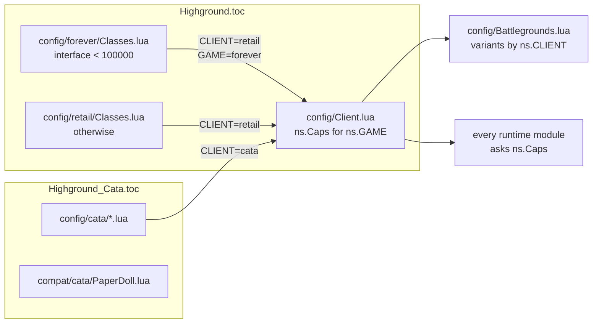
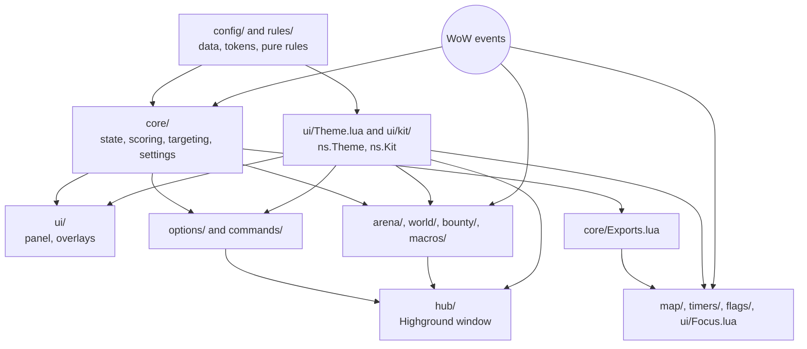

# Development

[Documentation](README.md) · [Project overview](../README.md)

Highground is plain Lua 5.1 (LuaJIT in tests) with no libraries. Each file gets the addon namespace through `local _, ns = ...`; there is no `require`.

This folder is one addon of a repository with several. Highground loads three kinds of code: its own (kill order, settings, the Highground window, `/hg`), the HighgroundKit library under `libs/`, and each standalone addon's code under `features/<name>/` (links to `addons/<Addon>/src/`). The [monorepo](../../../docs/monorepo.md) guide covers the layout and the rule that only Highground imports other addons.

## Repository layout

| Location | Responsibility |
| --- | --- |
| [features/battlegrounds/config/Shared.lua](../../HighgroundBattlegrounds/src/config/Shared.lua) | Armor and fallback role profiles |
| [libs/config/Theme.lua](../../../libs/HighgroundKit/config/Theme.lua), `libs/config/themes/` | Design tokens: the base theme and the Ember and Parchment themes ([design system](design-system.md)) |
| [libs/config/UI.lua](../../../libs/HighgroundKit/config/UI.lua) | Panel sizes, scale and opacity bounds, appearance choices, older colour names over the tokens |
| [config/Focus.lua](../config/Focus.lua) | Teammate pressure shields: clients, count, size |
| `features/battlegrounds/config/retail/`, `features/battlegrounds/config/forever/`, `features/battlegrounds/config/cata/` | Class IDs, spec profiles, matchups and range probes per game; Cata also auras, cooldown kits and spec clues |
| [libs/config/Client.lua](../../../libs/HighgroundKit/config/Client.lua) | Per-game capabilities (`ns.Caps`); each game's name, label, arena size and shared content (`ns.Games`) |
| [features/macros/config/Macros.lua](../../HighgroundMacros/src/config/Macros.lua) | Macro vocabulary (`Macros.Config`): units, raid markers, modifiers, sequence resets, equipment slots |
| [features/battlegrounds/config/Battlegrounds.lua](../../HighgroundBattlegrounds/src/config/Battlegrounds.lua), `features/battlegrounds/config/battlegrounds/` | Battleground registry and resolver; one rules file per battleground ([battleground rules](battleground-rules.md)) |
| [libs/config/Options.lua](../../../libs/HighgroundKit/config/Options.lua) | Settings catalog: pages, feature switches, behavior options, score components, bounds, client visibility |
| [config/Commands.lua](../config/Commands.lua) | Command catalog (`ns.CommandCatalog`): every `/hg` command and preview button |
| `features/battlegrounds/rules/` | Pure rules: range, flag stacks, cooldowns, spec inference. No WoW API calls |
| [libs/core/Util.lua](../../../libs/HighgroundKit/core/Util.lua) | Shared helpers (`ns.Util`), see [below](#shared-utilities) |
| [libs/core/Codec.lua](../../../libs/HighgroundKit/core/Codec.lua) | Base64 (`ns.Codec`) for profile and macro strings |
| `features/battlegrounds/core/` (State, Roster, Units, Auras, Specs, Lifecycle, Events, CombatLog, …) | The battleground engine: match state, roster, observations, event wiring |
| `core/` (Scoring, Targeting, Calling, Bursts, Preview, Diagnostics) | Kill order: scoring and target selection |
| [features/battlegrounds/core/Settings.lua](../../HighgroundBattlegrounds/src/core/Settings.lua) | One schema for settings from pages, commands, profiles and saved variables |
| [features/battlegrounds/core/Features.lua](../../HighgroundBattlegrounds/src/core/Features.lua) | `Core.SetFeature`, `Core.ResetTuning`, `Core.StopTest` |
| [features/battlegrounds/core/Migrations.lua](../../HighgroundBattlegrounds/src/core/Migrations.lua) | Saved-variable setup, validation and one-time upgrades |
| [core/Bursts.lua](../core/Bursts.lua) | Burst answers (PURGE or CC) for Cata burst markers |
| `features/battlegrounds/core/Capping.lua`, `features/battlegrounds/core/CapProbe.lua`, `features/battlegrounds/core/CapShare.lua` | Base captures in progress, diagnostics, sharing your own captures |
| [libs/core/Comms.lua](../../../libs/HighgroundKit/core/Comms.lua) | Addon messages (`ns.Comms`): group channel, send, one listener per prefix for captures, timers, map intel and bounties |
| [features/battlegrounds/core/Exports.lua](../../HighgroundBattlegrounds/src/core/Exports.lua) | Read-only core API for modules loaded later |
| [libs/ui/Theme.lua](../../../libs/HighgroundKit/ui/Theme.lua), `libs/ui/kit/` | Theme API (`ns.Theme`) and shared controls (`ns.Kit`) |
| `ui/` (Panel, Rows, Hero, Render, Layout, Actions, Tooltip, …) | Main panel, kill-target card, secure buttons, layout |
| `features/battlegrounds/ui/` (Compact, Appearance, Scale, CapPlates) | Compact docking, appearance, UI scale, capture bars |
| [libs/ui/Windows.lua](../../../libs/HighgroundKit/ui/Windows.lua), [libs/ui/Restore.lua](../../../libs/HighgroundKit/ui/Restore.lua) | HUD windows (timers, flags, arena, nearby) and the secure target-then-return macros |
| [libs/ui/Hud.lua](../../../libs/HighgroundKit/ui/Hud.lua) | Battleground panel rows (`Hud.UnitRow`) and the secure target/focus macros (`Core.SetTargetFocus`) |
| `ui/Sniper.lua`, `ui/HealerMarks.lua`, `ui/BurstMarks.lua`, `features/battlegrounds/ui/CapPlates.lua`, `ui/Focus.lua` | World overlays: target marker, healer crosses, burst markers, capture bars, pressure shields |
| [ui/Minimap.lua](../ui/Minimap.lua) | Minimap button and menu |
| `options/` | Settings pages: `State` (panel), `Root` (Profiles page), `Controls` (rows), `Register`, one file per page group, `Profiles` / `ProfileData` (named profiles, import, export) |
| `commands/` | `/hg` dispatch and handlers |
| `features/battlegrounds/map/` | Enemy map positions (`ns.Intel`), sharing, pins (`ns.MapPins`, `features/battlegrounds/map/Pins.xml`) |
| `features/battlegrounds/timers/` | Graveyards, capture nodes, resurrection estimates, predictions, battleground windows, map layer (`ns.Timers`) |
| `features/battlegrounds/flags/` | Flag carriers and the carrier window (`ns.Flags`); hides Blizzard's carrier frames and quest tracker |
| `features/arena/arena/` | Arena enemy panel (`ns.Arena`) |
| `libs/world/` | Nearby enemies (`ns.Nearby`) |
| `features/bounties/bounty/` | Bounties (`ns.Bounty`): `State` (model, events), `Messages` (actions and chat lines), `Sync` (guild messages), `Alerts`, `Marks` (nameplate coin, row frames), `Widgets`, `Board` (bounty board), `Driver` (events) |
| `features/macros/macros/` | Macros (`ns.Macros`), Highground Macros' code: `HostBase` (shared half of `Macros.Host`), with Highground's half in this addon's `macros/Host.lua` (the only file using Highground's `ns`), `Builder`, catalog (`General`, `Scripts` (script presets behind `scriptMacros`), `ClassesA`, `ClassesB`, `PvE`; Highground's own entries in `Highground`), `Ranks` (highest spell rank), `Compiler` (parse, diagnostics), `Explain` (plain English), `Analyze` (game checks), `Highlight` (syntax colours), `Merge` (keeps hand edits when options change), `Suggest` and `Sources` (autocomplete), `Store` (macro tabs), `Share` (export, import), window (`Window`, `Frame`, `Card`, `BuildPanel` layout, `BuildLogic` behaviour) |
| `hub/` | The Highground window (`ns.Hub`): `hub/Hub.lua` (sidebar, borrowing), `hub/Home.lua` |
| `compat/cata/` | Cata character-pane guard |
| `tests/` | Validator, unit tests and full-addon [simulations](simulations.md). The simulator (with its battleground extension), lint and test harness are in the repository's `tools/`; packaging, release and layout tests in its `tests/` |
| `../../scripts/` (repository root) | ZIP builds, GitHub release, CurseForge upload, shared-files release check ([releases](../../../docs/releases.md)) |
| `../../.github/workflows/` | CI: one workflow per addon, all calling `addon.yml` |

## Client isolation

Each TOC loads shared files and one class configuration. `Highground.toc` serves Retail and WoW Forever; each class file there returns early unless the interface number is its game's.



- `ns.CLIENT` (`"retail"` or `"cata"`) selects data: class tables, battleground variants, settings marked `cata = true` or `retail = true` in `config/Options.lua` (`ns.OptionAvailable`).
- `ns.Caps` says what the game's API allows: combat log, readable enemy health and power, spec trees, pings, Blitz. Check a capability, not a client name.

A new game needs a class configuration that sets `ns.CLIENT` and `ns.GAME`, and a row in `config/Client.lua`.

## Module boundaries



| Namespace | Owner | Holds |
| --- | --- | --- |
| `ns.Core` | `core/` | Match state, enemies, scoring, settings, feature switches |
| `ns.Util`, `ns.Codec` | `core/Util.lua`, `core/Codec.lua` | Shared helpers, base64 |
| `ns.Theme`, `ns.Kit` | `ui/Theme.lua`, `ui/kit/` | Tokens and controls |
| `ns.Options` | `options/` | Settings pages and profiles |
| `ns.Commands`, `ns.CommandCatalog` | `commands/`, `config/Commands.lua` | Handlers by first word; the listed commands |
| `ns.Intel`, `ns.MapPins` | `map/` | Enemy positions, map pins |
| `ns.Timers`, `ns.Flags` | `timers/`, `flags/` | Battleground timers and windows, carriers |
| `ns.Arena`, `ns.Nearby` | `arena/`, `world/` | Arena panel, nearby enemies |
| `ns.Bounty`, `ns.Macros` | `bounty/`, `macros/` | Bounties, macros |
| `ns.Hub` | `hub/` | Highground window |
| `ns.Test` | any | Test-only hooks for the simulator |

Rules between modules:

- **Core API.** [features/battlegrounds/core/Exports.lua](../../HighgroundBattlegrounds/src/core/Exports.lua) is the read-only core API for modules that load after core: `ns.enemies`, `ns.GetDB`, `ns.GetPositions`, `ns.IsActive`, `ns.GetKillNow`, `ns.GetBG`, `ns.GetBGRules`, `ns.CanonUnit` and more. Map, timers, flags and pressure shields use it. Prefer it in new code over `ns.Core` fields.
- **Changes with side effects** go through one function, used by pages and commands alike: `Core.SetFeature(key, on)` for switches, `Core.SetTuning(kind, key, value)` for validated tuning values, `Core.ResetTuning()`, `Core.StartTest()` / `Core.StopTest()`, `Theme.Use(name)`.
- **Bounty events.** `bounty/State.lua` is the model and never calls files that load after it. It emits events (`added`, `publish`, `changed`, `shared`, `claimed`, `updated`) through `Bounty.Emit`; Sync, Alerts and the board subscribe with `Bounty.Listen(event, fn)`. Each listener runs guarded.
- **Hub borrowing.** The Highground window draws no page itself. It reparents a settings page, the Profiles page, the bounty board or the macros window into its content area while shown, then hands it back. While borrowed, a window's `frame.close` is hidden and dragging is off. `Hub.Release(frame)` closes the hub when a command opens that window on its own. So the Blizzard panel keeps working unchanged.
- **Secure frames.** Click targets (rows, card, carriers, arena, nearby, key buttons) are secure. Their attributes, size, position and visibility change only out of combat; changes asked for in combat wait for `PLAYER_REGEN_ENABLED`. Battleground windows hide through `Timers.SecureHide` (fades out in combat) and show through `Timers.SecureShow` (waits for the end of combat). Kit controls are plain frames and work in combat.
- **Battleground rules** are resolved configuration. Runtime code must not change them.

## Shared utilities

`ns.Util` ([libs/core/Util.lua](../../../libs/HighgroundKit/core/Util.lua)) loads before everything else in core and has no load-time dependencies.

| Helper | Use |
| --- | --- |
| `Util.Say(text[, kind])` | The one chat line format: coloured **Highground** prefix, then text. `kind`: `"bounty"`, `"error"`, `"warning"` |
| `Util.Guard(stage, fn, ...)` | The one error wrapper: runs `fn` protected and records failures for `/hg err` |
| `Util.Events(handlers[, name])` | Event frame; each handler runs through `Util.Guard`; unknown events are skipped |
| `Util.Every(seconds, fn[, name])` | Guarded throttled update; returns a handle with `:Stop()` and `:Start()` |
| `Util.secret(v)`, `Util.plain(v)`, `Util.value(v)` | Secret values on Retail and Forever: test, readable boolean, value or nil |
| `Util.call(fn, ...)`, `Util.read(fn, ...)` | `pcall` returning results; first result when readable |
| `Util.Clean(s)` | Strip addon-message separators |
| `Util.Trim(s)`, `Util.Split(s[, sep])` | Trim spaces; split on one character (default `,`) into trimmed pieces, empty ones dropped |
| `Util.Plural(n, word)` | `"1 error"`, `"2 errors"`; an upper-case word takes `S` (`"2 ERRORS"`) |
| `Util.Ago(seconds)` | `"now"` (under 3 s), `"42s"`, `"7m"` |
| `Util.ClassName(class)`, `Util.SortClasses(list)` | A class token's name in the game's language; sort tokens by it |
| `Util.SpellName(id)`, `Util.SpellTexture(spell)`, `Util.SpellID(name)` | Spell data on every client (`C_Spell` or the old globals); `SpellID` gives your highest known rank. nil when unknown or secret |
| `Util.HealthFraction(unit)` | Health from 0 to 1, or nil (unknown, secret or no maximum) |
| `Util.ZoneName()`, `Util.Gold(n)`, `Util.AlertSound()`, `Util.MyTeam()`, `Util.ClassColor(class)` | Small game helpers |

Never compare a secret value or use it as a table key: pass it to `Util.value` first.

The kit has two small helpers for any frame ([libs/ui/kit/Controls.lua](../../../libs/HighgroundKit/ui/kit/Controls.lua)): `Kit.Tooltip(frame, lines[, opts])` adds a hover tooltip (a list of lines or a function returning one; the first line is the title), and `Kit.ClassIcon(texture, class)` shows a class icon from the game's atlas and returns whether it has one. See the [design system](design-system.md#kit).

## Saved variables

| Variable | Scope | Holds |
| --- | --- | --- |
| `HighgroundDB` | Account | Settings, feature switches (including `highestRank`, `highestRankMacros`, `scriptMacros`), tuning (`points`, `weights`, `specRatings`), `profiles`, appearance (`style`), `theme`, dialog positions (`windows`), bounties (`bountyPersonal`, `bountyGuild`), the macros window's preset mode (`macroMode`: `pvp`, `pve` or `ranks`), learned battleground data, `errors` |
| `HighgroundCharDB` | Character | Panel positions (`Core.POSITION_KEYS`) |
| `HighgroundMacrosDB` | Account | Highground Macros only: `macroMode`, `highestRank`, `highestRankMacros`, `scriptMacros`, `theme`, `windows`, `errors` |

In Highground, on `ADDON_LOADED`, `Core.LoadSaved` ([features/battlegrounds/core/Migrations.lua](../../HighgroundBattlegrounds/src/core/Migrations.lua)) creates both tables, fills `Core.DEFAULTS` ([features/battlegrounds/core/State.lua](../../HighgroundBattlegrounds/src/core/State.lua)), resets damaged values with `Core.ValidateSaved` (shapes in `Core.SavedDefs`, [features/battlegrounds/core/Settings.lua](../../HighgroundBattlegrounds/src/core/Settings.lua)) and runs one-time upgrades. Tuning values are checked against `Core.SettingDefs`. Profile imports are validated into a copy first ([options/ProfileData.lua](../options/ProfileData.lua)); an invalid known value rejects the whole profile, retired keys are ignored. Keep `false` booleans and explicit zero values.

Add an upgrade to `Core.LoadSaved` under a new version key (`Versioned`). Do not change an old one.

## Load order

Both TOCs load, in order: `config/` (themes right after `config/Theme.lua`, class files, battlegrounds, options, commands), `rules/`, the core state and scoring modules (starting with `core/Util.lua`), `ui/` (Theme API, kit, main panel and overlays, with the core modules that build on them), `options/`, the remaining core (combat log, migrations, events), `commands/`, `core/Exports.lua`, `map/`, `timers/`, `flags/`, `arena/`, `world/`, `bounty/`, `config/Macros.lua` and `macros/`, `timers/Exports.lua` (the simulator's test hooks), `ui/Focus.lua`, `ui/Minimap.lua` and `hub/`. The Cata TOC loads `config/cata/` instead of the Retail and Forever class files, and ends with `compat/cata/`. A file can use another at load time only if it loads earlier; otherwise look it up per call.

## Conventions

- No globals. `tests/validate.py` fails on global writes outside its allowlist (saved variables, slash commands, key bindings, names XML needs). Declare names `local` or put them on `ns`.
- Every runtime file must be in both TOCs (or only the client's own folder); the validator checks.
- Colours are theme tokens ([design system](design-system.md)).
- Chat output through `Util.Say`, errors through `Util.Guard`.
- **400 lines** per maintained text file, aim for under 300. Split at functions and features.
- Comments and docs: short and plain.
- When a command changes, update `config/Commands.lua` and [commands](commands.md) together; `tests/docs_test.lua` checks they match.

## Validation

Run from the repository root with Python 3.10+ and LuaJIT:

```sh
bash tests/run.sh
```

It runs, from each addon's folder, that addon's tests, then the repository's packaging tests. For Highground this runs the validator (manifests, XML, globals, colour literals, line limits, Lua 5.1 compilation), the unit tests and the [simulations](simulations.md); the repository's `tests/test_release.py` then checks packaging and releases. Simulations do not certify real in-client secure actions.

### Before release

Test both clients in combat:

- Join an ongoing flag match.
- Assault, defend and capture a graveyard.
- Turn the flags and timers features off and on.
- Enter two matches in a row.
- Click the card and enemy rows before and during combat, including a changed recommendation and right-click focus.

Capture unknown POI atlases, map IDs and chat messages for new fixtures. See [builds and releases](../../../docs/releases.md).
