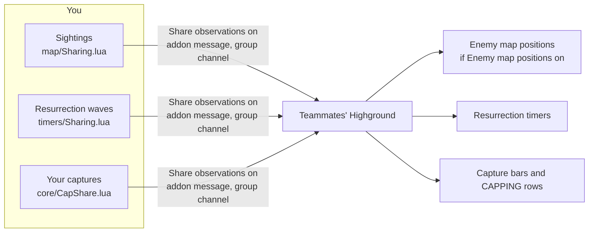
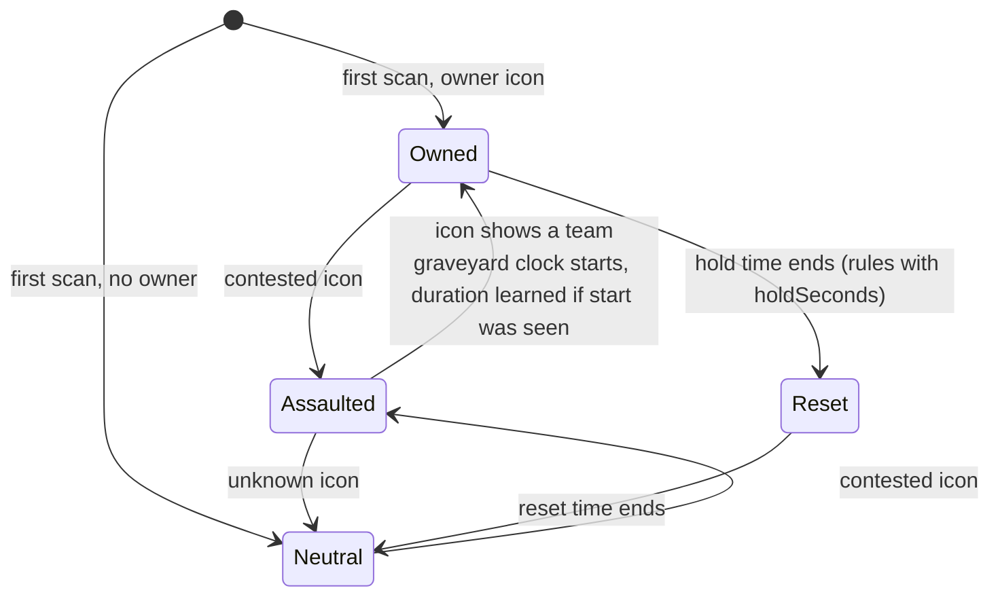

# Observations and timers

[Documentation](README.md) · [Highground overview](../README.md)

## Estimated specs (Cata)

The strongest clue is a talent-tree ability in the combat log, such as Mortal Strike (Arms), Scourge Strike (Unholy) or Riptide (Restoration). Only that tree's players have it, so the spec counts as identified, not estimated, and it works out of sight. Only the scoreboard outranks it. The ability list lives in [features/battlegrounds/config/cata/SpecClues.lua](../../HighgroundBattlegrounds/src/config/cata/SpecClues.lua) and matches English spell names.

Before then, Highground can estimate the spec from a configured personal buff, such as Shadowform or Moonkin Form. The buff must belong to the enemy's class and report that enemy as its caster. Shared buffs, unknown casters, stealable buffs and ordinary cat/bear forms do not identify a spec. Conflicting buff clues leave the estimate unknown.

Always-on buffs count too: Water Shield marks a Restoration shaman and Righteous Fury a Protection paladin.

At level 85, the configured mana heuristic treats pools below 40,000 as small and above 50,000 as large. It can distinguish some hybrid roles:

- **Shaman:** a small pool means Enhancement. A large pool with Lightning Shield means Elemental.
- **Paladin:** a small pool means Retribution, unless Righteous Fury shows Protection.
- **Druid:** a small pool in caster form means Feral.

Pools from 40,000 through 50,000 decide nothing, and this role heuristic does not compare other levels. These are configured estimates, not guaranteed spec identifiers.

Maximum mana compared with earlier matches is a weaker clue because gear changes mana pools and several specs can have similar pools. Highground learns from fresh observations paired with readable scoreboard specs, including recent observations confirmed after the match. Mana estimates require at least three samples for every spec in the class at the observed level, and a pool matching only one spec's observed range with a 10% tolerance. Missing examples, overlapping ranges, unknown levels and readings while shapeshifted remain inconclusive. Old samples without client and level context are not reused.

Readable scoreboard specs take priority, then talent-tree casts, then buff estimates, then previous-match history, then mana estimates. Estimates appear with `~` in rows and target cards; the row tooltip explains their source. Buff estimates can remain after the buff expires. Estimates never train the mana model, and the model stores at most 30 samples per class/spec, with at most one sample per enemy/spec in a match.

This fallback is Cata-only and depends on what the client can observe.

## Enemy map positions

Named battleground announcements for claiming, assaulting or defending a node place that enemy at the node with the announcement's timestamp, even when the enemy is out of view. The tooltip identifies the announcement and the pin ages, fades and expires normally. A later faction-only ownership announcement does not refresh the player's location. English Arathi and Gilneas message formats are supported; the actor must be identifiable on the enemy roster.

Enemy map positions distinguish readable unit/flag coordinates from estimates. A `~` marker indicates an area anchor or a position near the observer. Two inferences fill gaps without coordinates. A teammate without Highground who is in group range of you is treated as being in your area, so their combat places the enemy at your anchor. An observer who moves from an anchored area into a broad or unanchored one (a road, **Arathi Basin**, **Twin Peaks**, **Gilnean Coast**) is guessed to be near the area they left, for 15 seconds, with a radius that grows with time; the tooltip names that area. Dying ends the guess. Resurrection timers never use these guesses. A fresh sighting that still cannot be placed gets no map pin, and it replaces any stale position. Tooltips and the target card still show the enemy as **position unknown**. The player's resurrection destination is never used as their combat location.

A pin is in full colour for 4 seconds after a sighting. After that it turns greyer, fainter and smaller as it ages, fastest in the first half minute, and it disappears after 2 minutes. Its label shows the age in seconds.

Enemies sharing a position are spread into stable display slots sized for each map canvas. This spacing does not change their recorded locations.

Retail hides unit coordinates inside battlegrounds, so placement depends on named areas. Silvershard Mines has none, so its enemies are not pinned.

When sightings arrive within one second of each other, a known position takes precedence over an unlocated report. A teammate's melee range does not provide map accuracy unless that teammate's position is known. Later unlocated reports can still replace stale positions.

Cata Arathi Basin has fallback area anchors for all five bases and both starting areas. Live landmarks take precedence, and landmark updates refresh incomplete lists from loading screens. Sightings at these anchors show `~`; the broad area name **Arathi Basin** alone cannot place a fight on a particular road; it uses the recent-area guess above, then **position unknown**.

Configured capture points also supply fallback area positions when live landmarks are missing. In Cata Gilneas this covers **Lighthouse**, **Waterworks**, and **Mine/Mines**, with separate starting-area anchors for **Gilnean Stronghold** and **Horde Landing**. These remain approximate enemy sightings; capture points are distinct from resurrection destinations. Areas without a known anchor, including **Gilnean Coast**, use the recent-area guess, then **position unknown**. Cata Warsong Gulch anchors both flag rooms at the flag spawns.

Cata also records successful targeted casts from the configured range probes and immediate melee ability hits. Periodic ticks and delayed ranged damage cannot refresh a location.

Learned area anchors come from known player positions while carrying a flag. Older unqualified anchor samples are ignored: a dropped flag picked up in midfield does not locate either team's flag room. World-coordinate projection follows the north/west axis order and checks the world instance, following the [HereBeDragons coordinate implementation](https://github.com/Nevcairiel/HereBeDragons/blob/master/HereBeDragons-2.0.lua).

## Shared intel

**Share observations** controls sending only. Received data still feeds the timers; the map display follows **Enemy map positions**, and capture bars follow their own switches.

Intel sharing uses message version 3 to preserve position quality. Version 2 reports retain area/death information, but their unqualified coordinates are ignored because older versions could broadcast graveyard proxies. Teammates should update to exchange the new position data.

## Resurrection countdowns

Resurrection countdowns combine direct observations with estimates. Captured or contested graveyards discard the previous owner's clock. Enemy reappearances and shared votes can update an independently established graveyard; they cannot invent a graveyard at the fight.

An enemy seen alive again within one wave period of dying gives a vote: their wave came in between. A sighting with a known position or named area votes only for a graveyard there. A sighting with no location at all votes for the enemy's graveyard when their faction has only one. Deaths followed by a player's resurrection, Reincarnation or Feign Death get no vote.

Waves come every 30 seconds, or every 45 seconds in rated battlegrounds. If the match shows another period, the timers switch to it for that match. The signs are a spirit healer countdown longer than the period, or two pairs of exact waves spaced to fit it.

**One clock or one per graveyard.** Some servers run a single resurrection clock for the whole battleground. Every graveyard and both teams share the wave timing, and capturing a base does not restart it. Others time each spirit guide separately. Highground tells which by comparing exact waves seen at two different graveyards, for example your own spirit healer countdown and an enemy spirit guide's cast. The verdict is saved across matches. Once one shared clock is confirmed, a single exact observation times every graveyard on the map, including the enemy's, and capture-time estimates are ignored. Until it is confirmed, a graveyard never borrows another's clock. `/hg timers` shows the period and the clock verdict.

Base capture countdowns start at the "has assaulted" announcement, which is more precise than the map icon. The capture duration is learned from full assaults seen from announcement to capture. After three captures on a map and mode, their median replaces the configured duration, and `/hg timers` shows the duration in use. Captures seen without their start, and implausible durations, are not counted.

Each base is tracked from its map icon ([features/battlegrounds/timers/Nodes.lua](../../HighgroundBattlegrounds/src/timers/Nodes.lua)):

A countdown starts at the announcement when one arrived within 10 seconds of the icon change, otherwise at the scan. A base first seen already contested has no countdown.

Network latency and graveyard routing can still affect estimates. English POI-name matching and chat parsing remain localization gaps.

| Label | Meaning |
| --- | --- |
| **YOU** | Your reported resurrection destination |
| **OURS** | Another available friendly graveyard, or a friendly graveyard when your destination is unknown |
| **THEIRS** | An enemy graveyard |
| `~` | Estimated countdown |
| `--` | Unknown countdown |

Timer colors follow the factions, as on Blizzard's map: Alliance blue and Horde red, whichever side you are on. The **YOU**, **OURS** and **THEIRS** tags say which side is yours.

Cata Twin Peaks and Gilneas require the game's explicit destination before marking **YOU** or giving death-timing advice, because their routing cannot be inferred reliably from the nearest location. Without that information, friendly graveyards remain **OURS**. A known destination can show **YOU** with `--` while its wave timer is still unknown.

## Retail Silvershard Mines

Each faction has one graveyard, in its starting area. IDs 4062 (Alliance) and 4061 (Horde) and their positions come from the client data linked in [SilvershardMines.lua](../../HighgroundBattlegrounds/src/config/battlegrounds/SilvershardMines.lua); live positions take precedence by ID. Both graveyards are pinned from the start. Retail gives no coordinates and Silvershard has no named areas, so your healer countdown times your graveyard, and the enemy's comes from spirit-guide casts, a confirmed shared clock, or enemies seen alive again after dying.

## Cata graveyard behavior

### Warsong Gulch

Cata Warsong defines one **Base Graveyard** per faction using the match resurrection IDs 771/772. The flag-room spawn IDs 769/770 are excluded. Positions come from Cata client data linked in [WarsongGulch.lua](../../HighgroundBattlegrounds/src/config/battlegrounds/WarsongGulch.lua), with live positions taking precedence by ID.

Entering Warsong clears its obsolete learned graveyard entries, including duplicate base markers. Base landmarks, shared reports and nearby player positions cannot add another resurrection pin. Since each faction has one destination, its healer countdown or spirit-guide cast can identify the correct clock even when coordinates are unavailable. Your team's destination shows **YOU**; the countdown stays unknown until observed. Enemy reappearances with a known position or area still require a sighting near the actual graveyard before contributing an estimate.

### Twin Peaks

Cata Twin Peaks explicitly defines **Alliance Base Graveyard**, **Alliance Middle Graveyard**, **Horde Base Graveyard**, and **Horde Middle Graveyard**. Their separate IDs and fallback positions come from Cata client data linked in [TwinPeaks.lua](../../HighgroundBattlegrounds/src/config/battlegrounds/TwinPeaks.lua); the client's graveyard API takes precedence. Legacy learned positions cannot override those four entries.

Resurrection clocks remain unknown until observed, and an ambiguous team-wide observation cannot be assigned to either location.

### Battle for Gilneas

Cata Battle for Gilneas defines two permanent **Starting Graveyards** and the **Lighthouse**, **Waterworks**, and **Mine Graveyards**. Node graveyards are available only to the owner of an uncontested node. Their resurrection locations are separate from the capture flags; a contested or lost node clears its previous clock without removing either starting graveyard.

The definitions live in [BattleForGilneas.lua](../../HighgroundBattlegrounds/src/config/battlegrounds/BattleForGilneas.lua).

## Graveyard map labels

All battleground graveyard pins use compact names, with full names on hover. Timer-window names retain their full wording.

| Battleground | Map labels |
| --- | --- |
| Battle for Gilneas | **A Start**, **H Start**, **LH**, **WW**, **Mine** |
| Cata Warsong Gulch | **A Base**, **H Base** |
| Twin Peaks | **A/H Base**, **A/H Mid** |
| Other battlegrounds | Configured abbreviations such as **BS**, **LM**, **FR**, **SH**, or the shared shortening rule |

See [battleground rules](battleground-rules.md) for graveyard configuration and [battleground coverage](battlegrounds.md) for remaining objective-model limits.

## Banner clicks in progress (Cata)

Clicking a banner is a cast on the capper. While an enemy capper is visible (nameplate, target, mouseover or focus), the Objectives panel shows a **CAPPING** row with their name, the base you're in when they're near you and the exact time left. An orange **CAPPING** countdown bar appears above their nameplate (Capture nameplate bars setting; teammates get a blue one when friendly nameplates are on, and their captures and yours also get **CAPPING** rows in your team's color), their kill-order row shows `CAP` with an orange bar, and they gain the **Enemy capping a base** objective points. An alert sounds once per capture (Capture alert setting, behind the general sound switch).

The capture spell is learned automatically: when "X has assaulted the Y!" arrives as X's cast ends, that spell and its length are saved (`HighgroundDB.capSpells`). Your own captures teach it most reliably; until then, casts named Opening, Capturing, Assaulting or Claiming count. Once a spell is learned, a capture started out of view is estimated from the combat log (`~` time, dimmed bar) until it succeeds, fails or is interrupted.
