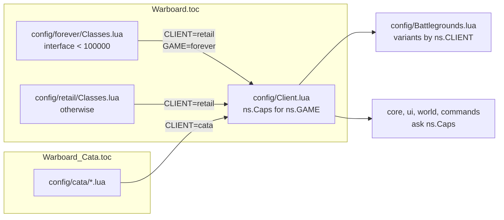
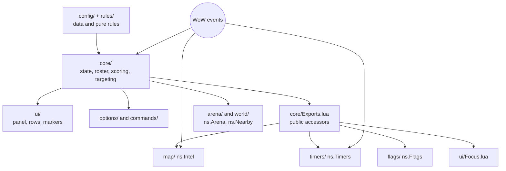

# Development

[Documentation](README.md) · [Project overview](../README.md)

## Repository layout

| Location | Responsibility |
| --- | --- |
| [config/Shared.lua](../config/Shared.lua) | Armor and fallback role profiles |
| [config/UI.lua](../config/UI.lua) | Shared palette, panel sizes, spacing and map label typography |
| [config/Options.lua](../config/Options.lua) | Settings catalog, score components, behavior defaults, units, bounds, pages, client visibility and legacy aliases |
| [config/Client.lua](../config/Client.lua) | Per-game capabilities (`ns.Caps`): combat log, readable enemy stats, spec trees, pings, blitz, default battleground scope |
| [config/Focus.lua](../config/Focus.lua) | Client support, count, colors and size of defensive focus badges |
| [config/retail/Classes.lua](../config/retail/Classes.lua) | Retail class IDs, 40 spec profiles, matchups and range probes |
| [config/cata/Classes.lua](../config/cata/Classes.lua), [Auras.lua](../config/cata/Auras.lua), [Kits.lua](../config/cata/Kits.lua) | Cata class profiles and ranges, aura categories, cooldown kits |
| [config/Battlegrounds.lua](../config/Battlegrounds.lua) | Validated registry and client/instance/mode resolution |
| `config/battlegrounds/*.lua` | One file per battleground: IDs, client overrides, captures, graveyards, scoring, carriers, map anchors and coverage |
| `rules/` | Pure range, flag-stack, cooldown and specialization-inference rules |
| `core/` | Runtime state, roster, unit observations, scoring, target selection and event lifecycle |
| `ui/` | Main panel, rows, health, hero rendering, secure actions, scale, sniper and focus markers |
| `options/` | Settings controls, scoring pages, spell tracking, profiles and registration |
| `commands/` | Slash-command dispatch, diagnostics, display controls and settings commands |
| `timers/` | Capture nodes, graveyards, resurrection evidence, prediction, windows and map layer |
| `flags/` | Carrier state, secure carrier window and Blizzard-frame visibility |
| `arena/` | Secure arena enemy panel (target/focus by arena unit) |
| `map/` | Coordinates, areas, sightings, sharing, pin mixin and XML template |
| `compat/cata/` | Cata-only client compatibility guards, including unavailable character-pane rune data |
| `tests/core/`, `tests/map/`, `tests/timers/`, `tests/focus/` | Focused regression scenarios with shared fixtures |
| `tests/simulation/` | Complete addon loader, simulated WoW APIs, deterministic clock and situation tests |
| `tests/` | Suite entry points, manifest and size validation, configuration and release tests |
| `scripts/` | Reproducible ZIP builds and GitHub release publication |
| `docs/` | Player guides and development references |
| `.github/workflows/ci.yml` | Test, package and release automation |
| `.pkgmeta` | CurseForge packaging: folder name, changelog and excluded development files |

## Client isolation and configuration

Each TOC loads shared defaults and exactly one class configuration. Cataclysm never loads Retail class data. `Warboard.toc` serves Retail and WoW Forever: both class files load, and each returns early unless the interface number matches its game.



Two names separate the games, and each has one job:

- `ns.CLIENT` (`"retail"` or `"cata"`) selects data: class tables, battleground variants, and settings that only exist on one client (`cata = true` or `retail = true` in [config/Options.lua](../config/Options.lua), read through `Core.IS_RETAIL`).
- `ns.Caps` ([config/Client.lua](../config/Client.lua)) answers what the API allows for `ns.GAME`. Code that registers the combat log, shows enemy health or mana, picks spec IDs, pings or detects blitz checks a capability, never a client name. WoW Forever shares the Retail client rules but has classic talent trees and no rated play.

A new game needs a class configuration that sets `ns.CLIENT` and `ns.GAME`, and a row in `config/Client.lua`. The battleground registry rejects unsupported clients and resolves instance variants before applying mode overrides. UI and rendering remain shared.

Resolved battleground tables are configuration and must not be mutated by runtime state. See [battleground rules](battleground-rules.md) for precedence, field definitions and the process for adding a map.

`core/Settings.lua` compiles the tuning schema and validates UI, command, profile and saved-variable values. Generic positive point values accept 0–500; penalties accept −500–0, with specific counts and thresholds declared in the catalog. `options/ProfileData.lua` prepares a validated copy before applying an imported or named profile. Preserve false boolean values and explicit zero spell overrides. Retired keys are ignored; invalid recognized imported values reject the whole profile.

Target eligibility is separate from score: known full immunities and preserved breakable CC cannot win through points. `core/Targeting.lua` supplies the same eligibility rule to selection, GO comparisons and explanations. Cata aura scans retain active cooldown IDs separately from estimated cooldown expiry times; failed aura reads must not create a defensive-spent event.

## Module boundaries



The TOCs define the runtime load order. Data and pure rules load first, followed by core/UI/settings modules, command handlers, map pins, map observations, timers, flags, the arena panel and focus markers. Each module receives the addon's private namespace through `...`; runtime code does not use `require`, source concatenation or environment replacement.

`ns.Core`, `ns.Options`, `ns.Intel`, `ns.Timers` and `ns.Flags` own their subsystem state. Cross-file accesses use those explicit tables; file-private helpers and caches stay local. Public accessors in [core/Exports.lua](../core/Exports.lua) connect the roster and match state to the map, timer and focus subsystems. Create a new namespace for unrelated state instead of adding globals.

Keep each maintained text file at **400 lines or fewer**, generally below 300 where a responsibility has a natural boundary. Split code at functions and features; keep tests grouped by situation. `tests/validate.py` checks new and tracked files, compiles every Lua module, and rejects runtime files missing from either client manifest. Ignored generated artifacts in `dist/` and `graphify-out/`, and binary assets, are outside the line limit.

## Validation

Run from the repository root with Python 3.10+ and LuaJIT installed:

```sh
bash tests/run.sh
```

The suite checks both manifests, XML script references, file sizes, Lua 5.1 compilation, configuration isolation, class mapping, range/scoring behavior, capture/ownership transitions, resurrection state, message queue timing, map observations, carrier controls, enemy focus markers, settings migration, spell inheritance and profile compatibility. It also checks packaging and publication behavior with GitHub writes mocked.

Full-addon simulations load the actual TOC and XML scripts, then deliver events, advance time and inspect rendered widgets, secure macros, packets and state. They fail on recorded addon errors as well as scenario assertions. See [simulations](simulations.md) for commands and a scenario example.

WoW APIs and protected-frame restrictions are simulated. Tests do not certify actual in-client secure actions or private-server API behavior.

### Before release

Exercise both clients in combat:

- Join an ongoing flag match.
- Assault, defend and capture a graveyard.
- Toggle the flags/timers features.
- Enter consecutive matches.
- Click the hero and enemy rows before and during combat, including a changed recommendation and right-click focus.

Capture unknown POI atlases, map IDs and localized messages for new fixtures. The [coverage guide](battlegrounds.md) lists mechanics still needing work, and [observations and timers](observations.md) documents the distinctions those fixtures should preserve.

See [builds and releases](releases.md) for packaging, versioning and CI publication.
